# Evernear

by luca_m

Evernear is an agent that sources a scarce part, checks it fits, negotiates, commits the money and pays the supplier only for what arrived, on NEAR. The buyer's money stays in the buyer's own wallet the whole time; Evernear never holds funds.

> **Status, Nov 6 2026.** Every NEAR call runs on testnet. The per-PO escrow and the payout run on [Tidepool](#tidepool), a community-run testnet of the NEAR Intents Agent API, at 1:1,000 of the story amounts. The money steps are real: a full order ran live through the release gate in OutLayer's enclave on Nov 6, and the happy path replays that run from [`fixtures/recorded/live-run.json`](fixtures/recorded/live-run.json) (read from the Convex proofs table) with its real hashes and explorer buttons. Still synthetic, and labelled so: the steps before the money (Astro's wallet and rules, the routine reorder, private inference, the Gmail counter offer, the approvals), the attested dock check (its worker is not deployed), the bad paths, and the shipment signals, which come from a simulated tracking feed in live runs too.

**Built at NEAR HACKATHON.** All of Evernear's code was written within the hackathon period (Nov 1 to Nov 14, 2026). The first commit in this repository is dated Nov 5, 2026 (`git log --reverse`). The only code not written for the hackathon is third-party: the npm dependencies in `package.json` and the figure library in [vendor/anatomy](vendor/anatomy/LICENSE) (MIT, credited below).

**AI agents and reviewers:** start with [docs/AGENT-GUIDE.md](docs/AGENT-GUIDE.md). It covers what each folder decides, how to run the project with no keys, how to check any claim below against its test, and what is real versus simulated.

## Run it

| Mode | Needs | Command |
| --- | --- | --- |
| Demo | Nothing | `npm ci && DEMO_MODE=1 npm run demo`, then open `http://localhost:3000` (`?scene=7` jumps to chapter 7 of 8, `?mode=light` for light) |
| Testnet | OutLayer testnet key, NEAR AI key, a Tidepool key with Astro's testnet owner and treasury, Convex | copy `.env.example` to `.env.local`, fill it in, `npx convex dev`, `npm run dev` |
| Present or Autoplay | Nothing | Top right: **Present** moves one narratable step at a time ("Next: ..." or Cmd+K), waits for your clicks at each approval, and is what to record with; **Autoplay** plays the chosen scenario start to finish. Scenarios: **Happy path**; **Bad path** (Haoyun and QuickShip both hold at +10%, over the 5% ceiling, and Evernear stops before any money moves); **Bad path, adjusted** (you raise the ceiling to 10% with two approvals and Haoyun's all-50 offer goes through at $1,320: $66,000 committed, $19,800 advance, $38,280 balance, $7,920 held). Every amount is computed by the engine ([scenes.ts](scenario/scenes.ts), [gates.ts](scenario/gates.ts), [tests](scenario/__tests__/scenarios.test.ts)) |
| Live | Testnet setup above, `LIVE_ENABLED=1` in the Convex env | `npm run dev`, then press "Replay" to switch it to "Live": when the story reaches each money step (commit, the wrong address, the payout, the reclaim) the clock holds while it runs for real on Tidepool testnet, and the drawer shows the real tx ([live.ts](convex/live.ts), [useLive.ts](components/workspace/useLive.ts), [test](tests/live.test.ts)). Amounts and addresses are fixed on the server; one run at a time, 6 an hour; an abandoned run is refunded by its 30 minute deadline |
| Rehearsal | Testnet keys plus the `REHEARSE_*` accounts in [steps.ts](scripts/rehearse/steps.ts) | `RECORD=1 npm run rehearse` runs the scenes on testnet and writes real proofs to `fixtures/recorded/`; refuses missing keys and any mainnet host, and commits nothing before both approvals ([test](tests/record.test.ts) "rehearsal") |

Checks: `npm run typecheck && npm run lint && npm test && npm run check:ip`. With the app running, `npm run check:frames -- --url http://localhost:3000/` walks all three scenarios in Chrome at 1920x1080 pressing Cmd+K and checks every zoom (below).

## The story

Astro Robotics, a robot maker in Chicago, has 500 orders for its 10MA robot, all due to ship by Dec 14, and parts for 450: it is 50 AM-17 actuator motors short. Its usual supplier is out for 6 weeks. Evernear searches five alternatives against the 10MA's bill of materials and the date, negotiates with the two that fit (Haoyun Precision in Shenzhen and QuickShip Motion in Busan) inside a 5% urgent ceiling, recommends Haoyun's all-50 offer at $1,260, gets two approvals and commits $63,000 into the order's own wallet. It pays in two stages: a $18,900 advance once the bill of lading and export clearance are in, and a $36,540 balance once import customs and the attested dock count agree (44 of 50 arrived). The $7,560 for the 6 missing motors never leaves Astro's control.

## What each chapter does

| # | Chapter | NEAR call | File | Test |
| --- | --- | --- | --- | --- |
| 1 | The 10MA: Astro's wallet and rules, the product and its actuator motor | OutLayer custody `POST /register`, owner policy with whitelist and cap | [custody.ts](convex/near/custody.ts) | [adapters.test.ts](tests/near/adapters.test.ts) "custody" |
| 2 | The gap, with a routine reorder under the cap that pays itself | custody `POST /wallet/v1/call` `ft_transfer`, no human step | [scenarios/demand.ts](scenarios/demand.ts), [custody.ts](convex/near/custody.ts), [policy.ts](engine/policy.ts) | [channels.test.ts](tests/channels.test.ts) "demand simulator", [engine.test.ts](engine/__tests__/engine.test.ts) "approvals", [runner.test.ts](scenario/__tests__/runner.test.ts) "routine reorder" |
| 3 | Ultra's reply: out for 6 weeks, past Dec 14 | none (inbound email) | [scenes.ts](scenario/scenes.ts) | [scenarios.test.ts](scenario/__tests__/scenarios.test.ts) |
| 4 | Search: five suppliers on the map, with the reason each one fits (Haoyun, QuickShip), is close (Kansai, late) or fails (Rheinwerk, Huaxin) | NEAR AI Cloud private inference with attestation | [inference.ts](convex/near/inference.ts), [plain.ts](engine/plain.ts) | [adapters.test.ts](tests/near/adapters.test.ts) "private inference", [engine.test.ts](engine/__tests__/engine.test.ts) "fitment" |
| 5 | Negotiation: two email threads side by side, both down from +10%; Haoyun all 50 at +5%, QuickShip 38 now at +10%; Stockbot's comparison; Luca picks Haoyun | OutLayer Gmail connector `send`, allowlisted | [gmail.ts](convex/near/gmail.ts), [suppliers.ts](scenarios/suppliers.ts) | [adapters.test.ts](tests/near/adapters.test.ts) "gmail connector", [channels.test.ts](tests/channels.test.ts) "supplier simulator" |
| 6 | Approve and commit: two signatures, then $63.00 (1:1,000) into one Agent API account per PO on Tidepool, policy `destinations: only` [withdraw to Haoyun on Base Sepolia, transfer to Astro] | custody approvals `POST /wallet/v1/approve/{id}`; Agent API account and transfer | [approval.ts](convex/near/approval.ts), [escrow.ts](convex/near/escrow.ts), [agentapi.ts](convex/near/agentapi.ts), [deadline.ts](convex/near/deadline.ts) | [adapters.test.ts](tests/near/adapters.test.ts) "approvals", [escrow.test.ts](tests/near/escrow.test.ts) "EscrowAdapter on the Agent API", [deadline.test.ts](tests/deadline.test.ts) |
| 7 | Shenzhen to the Chicago dock: the advance on departure (bill of lading and export clearance), then the balance at the dock (import customs and the attested count, 44 of 50) | OutLayer worker, attested over code, input and output | [dockcheck.ts](convex/near/dockcheck.ts), [worker/dock-check](worker/dock-check/src/lib.rs) | [dockcheck.test.ts](tests/dockcheck.test.ts) |
| 8 | Paid, what the escrow protected, then the end line | Agent API withdraws of $18.90 and $36.54 to Haoyun on Base Sepolia, $7.56 back to Astro at the deadline, then the wallet closes; a withdraw to a wrong address refused live by the account's policy | [escrow.ts](convex/near/escrow.ts), [deadline.ts](convex/near/deadline.ts) | [escrow.test.ts](tests/near/escrow.test.ts), [deadline.test.ts](tests/deadline.test.ts) |

## Presenter camera

Record with any screen recorder and the zooms are already in the video. Each named step in the story can carry a focus (an element's `data-focus` id, a zoom from 1.0 to 2.5, a hold, an optional spotlight that dims the rest to 40%). When the step runs, everything but the demo rail pans and scales in one CSS transform so the element sits in the middle, holds, then eases back to the full view unless the next step has its own focus: 700 ms in, 500 ms out, a spring with no more than 2% overshoot. The layout is scaled, not a bitmap, so text stays crisp. **F** turns the camera on or off, **Z** follows your clicks (1.4x toward each click, back after 2 s without one), **0** returns to the full view, **C** turns the presenter cursor on or off, and the right arrow plays the next step and its zoom. With the reduced motion setting the moves are cuts. Open `/present` in a second window of the same browser for a remote that shows the current focus and can preview or skip the next zoom. Focus plan and maths: [scenes.ts](scenario/scenes.ts), [camera.ts](scenario/camera.ts), [Camera.tsx](components/workspace/Camera.tsx), [Remote.tsx](components/workspace/Remote.tsx). Tests: [camera.test.ts](scenario/__tests__/camera.test.ts) (targeting, spring, the 18-step plan), [camera.test.tsx](components/__tests__/camera.test.tsx) (hold, return, reduced motion), [focus.test.tsx](components/__tests__/focus.test.tsx) (every focus id exists in the DOM for its chapter, in all three scenarios).

| Chapter | Step | Focus | Zoom |
| --- | --- | --- | --- |
| 1 | Product switch | `products.figure` | 1.5x |
| 1 | Motor highlight | `products.motor` | 2.2x |
| 2 | The gap | `stock.shortfall` | 1.8x |
| 3 | Ultra's reply | `inbox.reply` | 1.7x |
| 4 | Search typed (the query and "Comparing suppliers: 0 of 5") | `map.search` | 1.8x |
| 4 | Private inference (explainer) | `developer.attestation` | 1.5x |
| 4 | Attestation (explainer) | `developer.attestation` | 1.8x |
| 4 | Pins resolve (the map fills its card, so this frames the whole map) | `map.results` | 1.4x asked, about 1.0x fitted |
| 4 | Orange reasons (spotlight on Kansai's pin) | `map.results.partial` | 2.0x |
| 5 | Offers side by side | `negotiation.threads` | 1.3x |
| 5 | Haoyun's offer | `negotiation.haoyun` | 1.9x asked, fitted to the thread |
| 5 | Recommendation | `negotiation.compare` | 1.6x asked, fitted to the card |
| 6 | Approvals | `rules.approvals` | 1.8x |
| 6 | Funds move | `money.escrow` | 2.0x |
| 6 | Order wallet (explainer) | `developer.policy` | 1.6x |
| 7 | Dock count | `dock.count` | 2.0x |
| 7 | Signed result (explainer) | `developer.signed` | 1.7x |
| 8 | Paid and refused | `money.payout` | 1.8x |
| 8 | Wallet lifecycle (explainer) | `money.lifecycle` | 1.6x |

### Every zoom shows its card in full

Each step with a focus declares what its frame must show (`shows` in [scenes.ts](scenario/scenes.ts): text such as "Committed for PO 1042"). The camera waits until the focused element holds all of it, measures two frames later so the card has laid out, zooms so the whole element fits with 48 px around it, and measures again when the move lands, correcting the frame if the content grew ([Camera.tsx](components/workspace/Camera.tsx)). Nothing in a focused element is cut with an ellipsis; hashes and addresses shortened on purpose carry `data-abbr` and their full value on hover. Tests: [frames.test.tsx](components/__tests__/frames.test.tsx) (in all three scenarios every zoom declares what it shows, the element holds all of it at its step, no cut text; and over 2,000 random elements the camera's frame keeps each one inside the viewport with padding), [camera.test.tsx](components/__tests__/camera.test.tsx) (it waits for the declared text). In a real browser, [check-frames.mjs](scripts/check-frames.mjs) checks with layout that each zoomed element is inside the 1920x1080 viewport, that no box inside it cuts its text, that every declared text is on screen and not scrolled away, and lists cut text on the other cards; the last run passed all 22 zooms of the happy path, 11 of the bad path and 21 of the adjusted path, with no cut text on any card.

What changed so no step talks over an empty card:

- Chapter 1: Astro's wallet is on the Money card from the first frame. In Live the wallet says Connecting until the Tidepool key answers, then Connected with the treasury's balance.
- The steps in a chapter's first 1.6 s play with the press that enters the chapter (`rides`, [scenes.ts](scenario/scenes.ts) `buildTimeline`): entering chapter 2 shows the gap, chapter 3 delivers Ultra's reply, chapter 4 runs the search, chapter 5 lands both quotes in their threads, chapter 6 sends the approval card, chapter 8 tries the lookalike payment. A human moment always waits for its own press.
- Chapter 2: the gap's zoom frames the headline and the chart together.
- Chapter 4: the map has the card to itself and fills it. While the search runs, "Comparing suppliers: 0 of 5" counts up; each supplier's pin appears as it is checked, with its name and one line of why in green, orange or crimson (fits, late, missing parts, fails policy; the exact failing specs on hover); "2 fit, 1 late, 2 fail" when it is done. No supplier pins before the search.
- Chapter 5: the Inbox has the room beside the phone. Every email in both threads shows in full; the threads are as tall as their emails and scroll on their own only if they outgrow the card; a new email scrolls its thread to it and is lit for 4.5 s; Stockbot's comparison is a full-width card under both threads.
- The drawer's explainer column grows to fit and wraps long values instead of cutting them.
- An explainer (the attestation, the signed result, the wallet lifecycle) stays open and zoomed until your next press; it closes with the step that press plays, never while the clock runs between stops. Test: [gates.test.ts](scenario/__tests__/gates.test.ts) "explainers stay up while you talk".
- Live (chapters 6 to 8): while a money step runs, the Money card says what is happening ("Committing $63.00 on Tidepool testnet") and the drawer opens on the entry, which shows Confirming, then its View on NearBlocks or View on Basescan button. Cmd+K does nothing until the step is confirmed, and a press while the clock is still on its way stops at the step instead of passing it. Tests: [liveStatus.test.tsx](components/__tests__/liveStatus.test.tsx), [liveGate.test.tsx](components/__tests__/liveGate.test.tsx).

Cmd+K presses per chapter, from the browser run (the page opens on chapter 1):

| Scenario | 1 | 2 | 3 | 4 | 5 | 6 | 7 | 8 | 9 | Total |
| --- | --- | --- | --- | --- | --- | --- | --- | --- | --- | --- |
| Happy path | 2 | 1 | 3 | 5 | 11 | 6 | 8 | 5 | | 41 (was 49) |
| Bad path | 2 | 1 | 3 | 5 | 9 | 2 | | | | 22 |
| Bad path, adjusted | 2 | 1 | 3 | 5 | 9 | 7 | 6 | 8 | 5 | 46 |

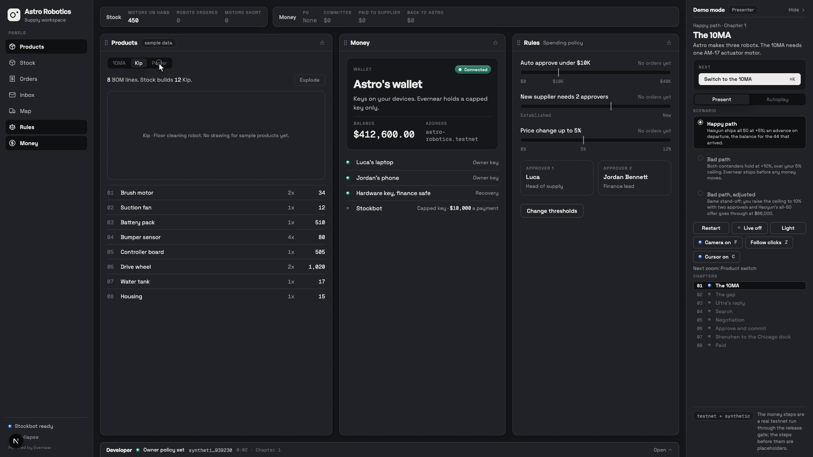
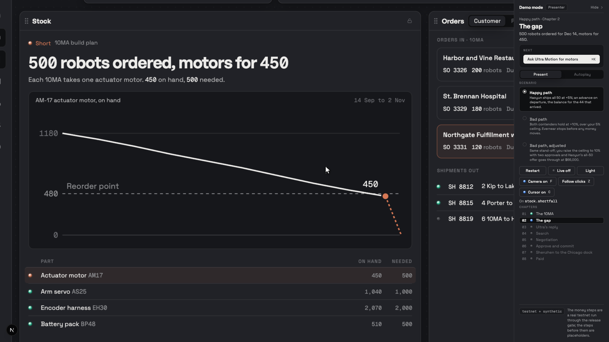
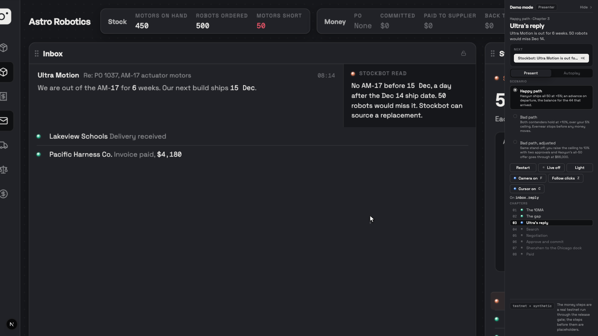
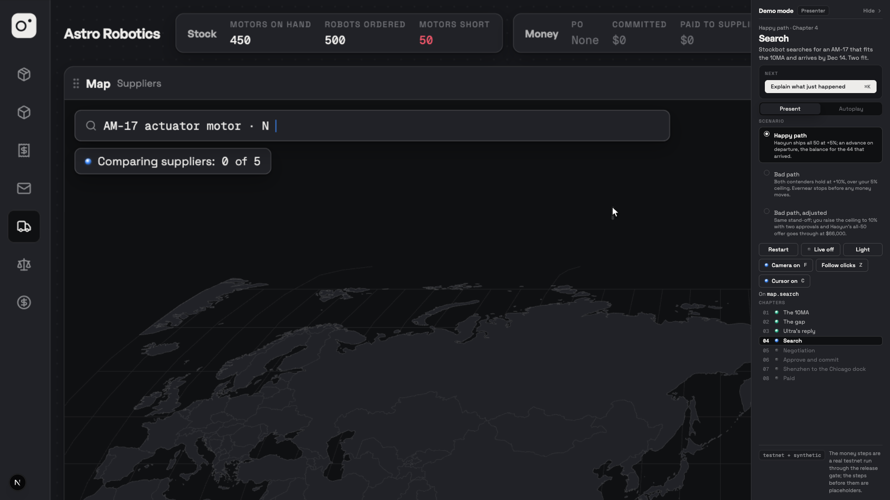
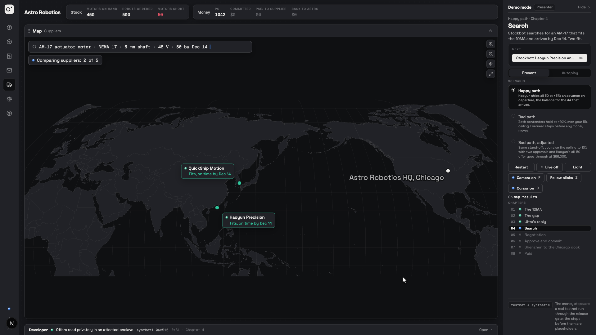
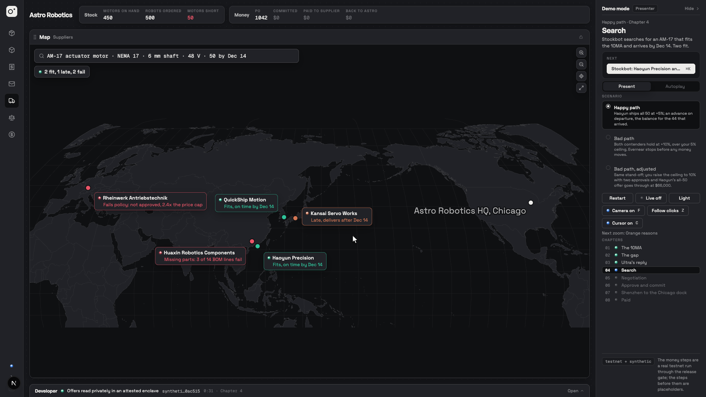
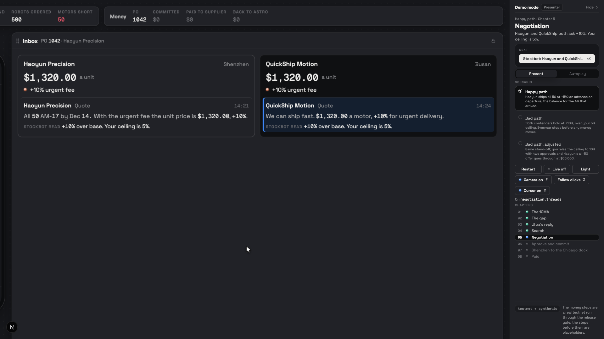
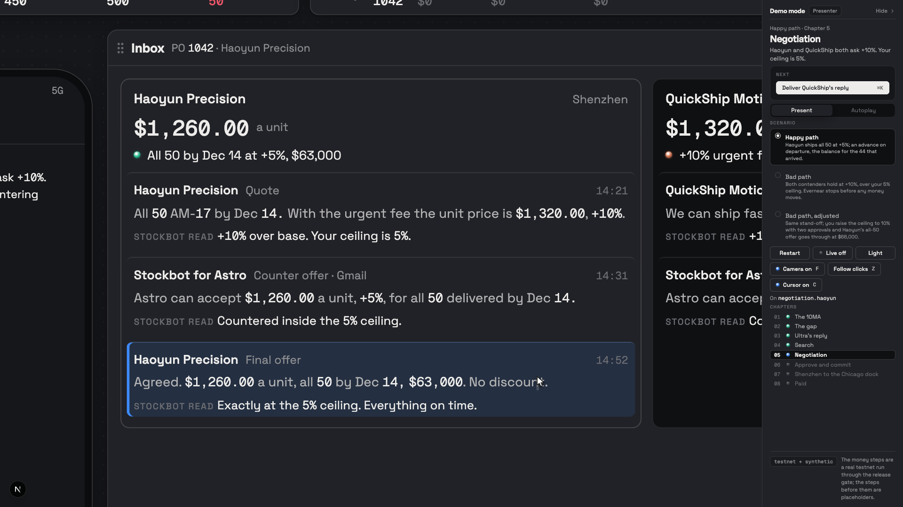
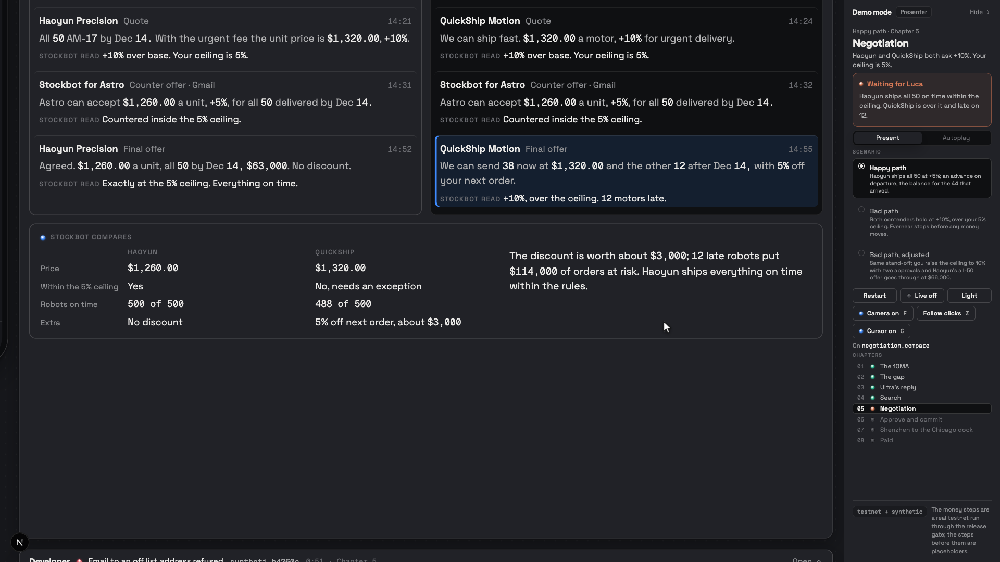
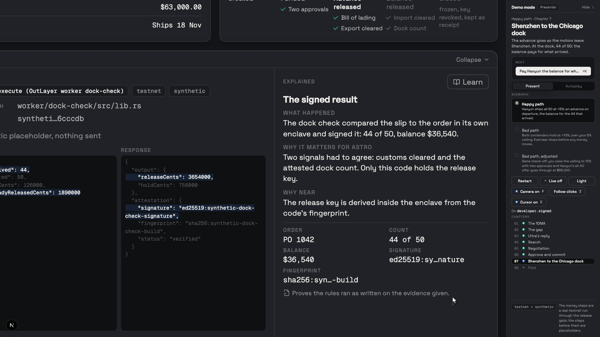

### Short mode

For a short video recorded hands-free, **Short** in the demo panel (or `?mode=short` in the URL) plays the happy path as 9 sections by itself. One press of Play (or Cmd+K) starts the run: the starting view (Astro Robotics with the 10MA on screen) holds for an 8 s hook, then each section plays its animation, with the presenter cursor doing the taps (the 10MA tab, Start sourcing, Choose Haoyun, both YES approvals, the packing slip) and the zooms timed inside it, holds on its final frame until its speaking time is up, pauses 2.5 s, and the next starts on its own. Speaking times: the company 8 s, the gap 9 s, search 13 s, negotiation 11 s, approve and commit 12 s, ship and dock 9 s, paid 7 s, on chain 9 s, end frame 4 s, then the end frame holds 14 s for the outro and the run stops: 124 s in all. They live in one table, `TIMING` in [short.ts](scenario/short.ts); `?pace=` scales the talking times and `?gap=` sets the pause in seconds. Space pauses and resumes; Cmd+K skips to the next section; the left arrow replays the current one. Nothing on the recorded screen counts down; the `/present` remote shows "Section N of 9", the time left in it and the next section's name. Live is always off, and the drawer replays the recorded testnet run, so "On chain" holds the drawer on the commit with its real hash and its View on NearBlocks button. The Money card's badges show the story's own dates ([storyDates.ts](scenario/storyDates.ts): committed 3 Nov 14:58 after the approvals, advance 7 Nov 01:40 at departure, paid 11 Nov 08:42 at the dock); the drawer keeps the real timestamps. While an explainer's proof is a synthetic placeholder, the drawer shows only the Explained column and its diagram ([Drawer.tsx](components/workspace/Drawer.tsx)). The search map places its labels so none overlaps ([labels.ts](components/workspace/map/labels.ts)). Tests: [short.test.ts](scenario/__tests__/short.test.ts) (the table, the run's length, the hook, pace and gap, every tap reachable, the run replays the happy path), [short.test.tsx](components/__tests__/short.test.tsx) (nothing before Play, the whole run with no presses at the table's length, Space, Cmd+K, no countdown on screen, the remote, every zoom target, the explainer alone, the badge dates), [shortLive.test.tsx](components/__tests__/shortLive.test.tsx) (Live cannot turn on), [mapLabels.test.ts](components/__tests__/mapLabels.test.ts) (no overlaps from a 900 to an 1800 px map). In a real browser: `node scripts/check-frames.mjs --scenario short --size 1440x900` ([check-frames.mjs](scripts/check-frames.mjs)).

### Presenter cursor

So the video shows a cursor at work while you only press **Cmd+K** or the right arrow, Present mode draws its own cursor (a macOS arrow with a soft shadow). On a step that is a click in the app, it glides there in 450 to 700 ms, presses (a small press plus a ring), and only then does the change happen. On a step that only animates (a chart, the ship, a payment, a message) it never clicks; it rests beside the step's content. It moves inside the camera's transform, so it lands on the right spot at every zoom and keeps its size on screen. It only clicks elements inside the workspace, never the demo rail (Live, Restart, the scenario picker). While it is on, the system cursor is hidden over the workspace and comes back once the mouse moves more than 40 px; your next step from the keyboard hands control back to the cursor. Clicking a phone button yourself still works at once. **C** turns it on or off (on in Present, off in Autoplay; the demo rail shows it beside Camera). With reduced motion it jumps and still shows the ring. Rules: [cursor.ts](scenario/cursor.ts), drawing and timers: [Cursor.tsx](components/workspace/Cursor.tsx). Tests: [cursor.test.ts](scenario/__tests__/cursor.test.ts) (glide times, which steps click, nothing forbidden), [cursor.test.tsx](components/__tests__/cursor.test.tsx) (every click target exists in the DOM inside the camera just before its step, in all three scenarios; the waits are answered from Cmd+K with the press first; never the Live button).

| Chapter | Step | The cursor clicks |
| --- | --- | --- |
| 1 | Kip, Porter, then the 10MA | The product's tab (`products.tab.*`) |
| 3 | Start sourcing | The Inbox's Start sourcing button (`inbox.start`) |
| 5 | Choose Haoyun | The chip on the phone (`phone.tap`) |
| 6 | YES, approve as Luca; YES, approve as Jordan | YES on the phone's approval cards |
| 7 | Send packing slip photo | The button under the phone's chat |
| Bad paths | End the order; Raise to 10%; YES, approve as Jordan | The phone's chip or button |

## Evernear explains itself

Five moments explain the architecture on screen: the camera zooms to the panel, the developer drawer opens on the matching step, and its right column says what happened, why it matters for Astro and why NEAR, in under 25 words each, with figures from the engine. **Learn** swaps the three lines for a small diagram. The drawer's three columns answer three questions: **Steps** (what has happened, with an icon per kind), **Proof** (the call, network, code path, hash, then the request and response with the two or three fields that matter lit), **Explained** (what it means). Text in the opened drawer is at least 14px.

| Moment | Chapter | Proof | Diagram |
| --- | --- | --- | --- |
| Private inference in an enclave | 4 | NEAR AI Cloud private inference | Enclave |
| The attestation | 4 | the same call's attestation: signer, code fingerprint, verified | Attestation chain |
| The order's own wallet | 6 | the PO account: its two allowed destinations, the capped agent key, owner Astro | Order wallet |
| The signed result | 7 | the attested dock check: order, count, amount, signature, fingerprint ("Proves the rules ran as written on the evidence given.") | Signed result |
| Paid on their chain, then the wallet closes | 8 | the payout, then "Wallet closed" | Wallet lifecycle, also on the Money card |

Each order wallet serves one order and is never reused: once settled it is frozen, Evernear's grant is revoked, and it stays as the order's receipt; a closed wallet refuses every move ([escrow.ts](engine/escrow.ts) `closeWallet`). Content and tests: [explain.ts](scenario/explain.ts), [Drawer.tsx](components/workspace/Drawer.tsx), [Diagrams.tsx](components/workspace/Diagrams.tsx), [explain.test.ts](scenario/__tests__/explain.test.ts).

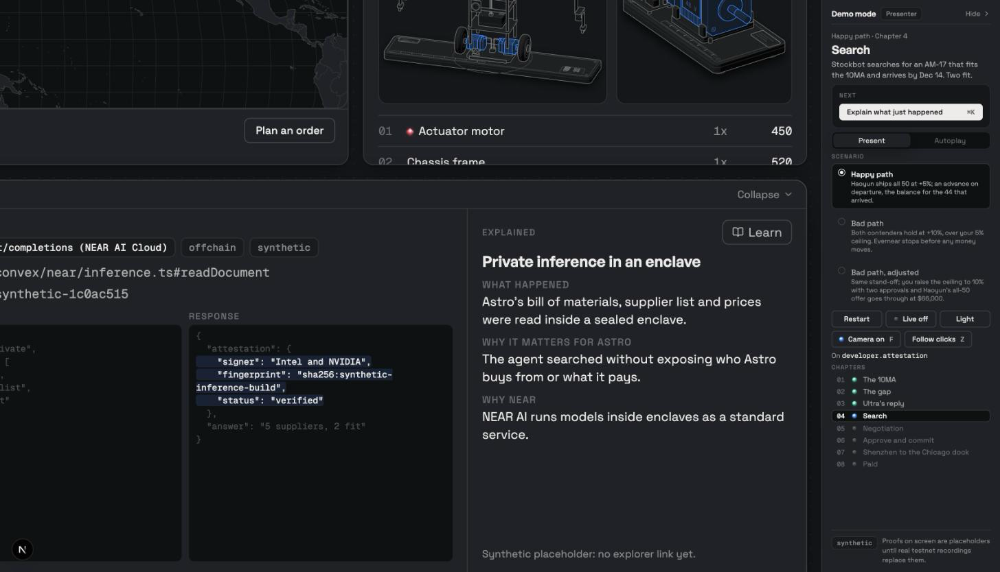
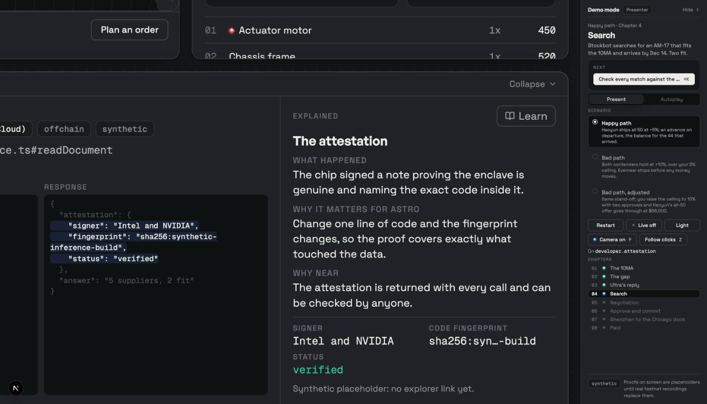
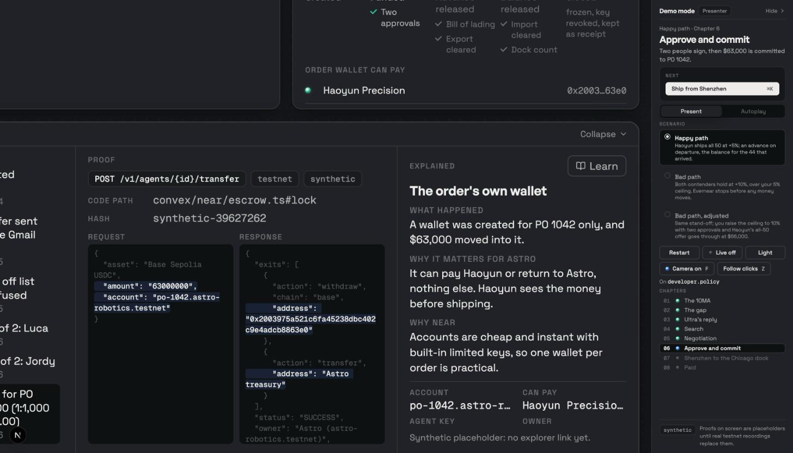
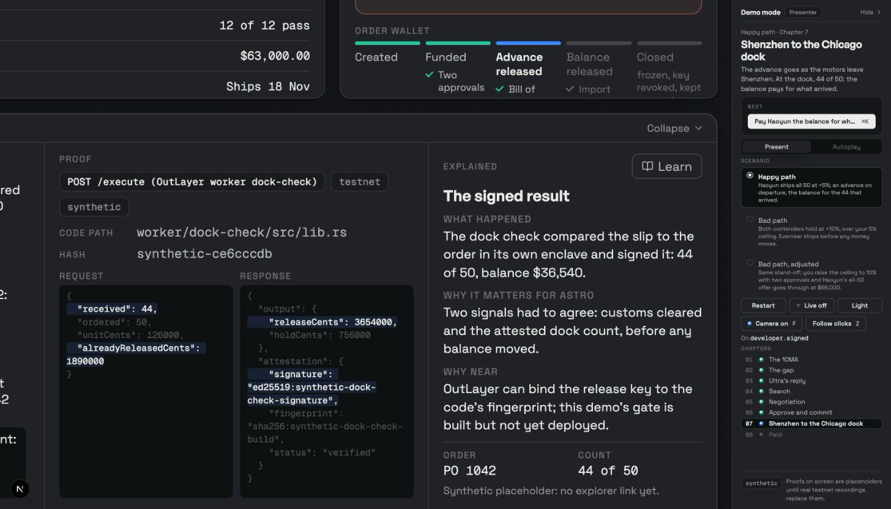
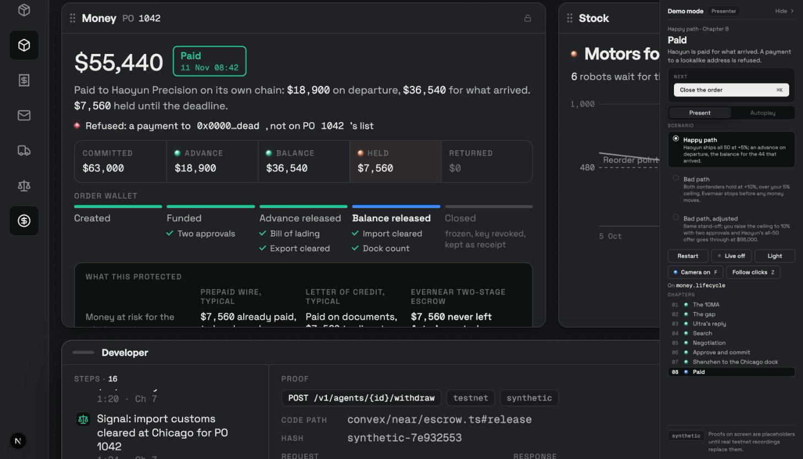

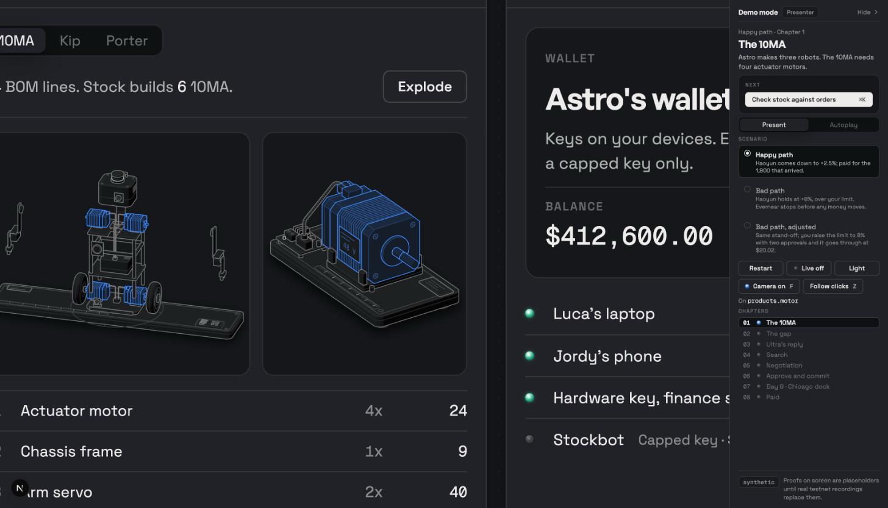
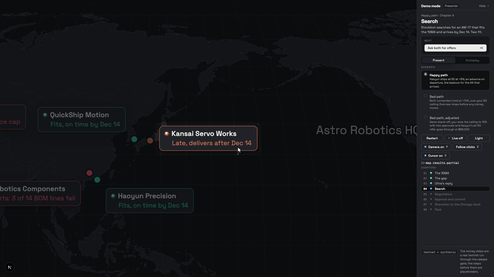
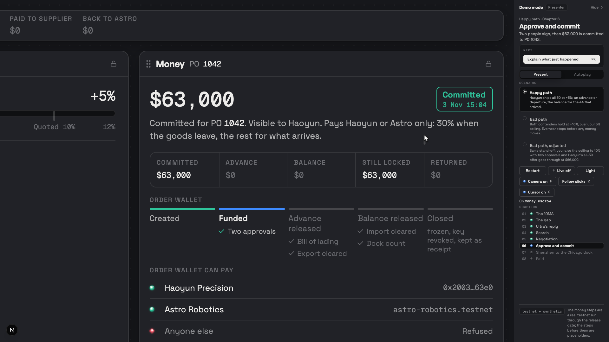

## Acceptance checks

| Check | Test |
| --- | --- |
| Routine reorder under the cap pays with no human step | [engine.test.ts](engine/__tests__/engine.test.ts), [runner.test.ts](scenario/__tests__/runner.test.ts) |
| Fitment: Haoyun passes; Kansai fits but cannot deliver before Dec 14; Rheinwerk fails on policy; Huaxin on exactly 3 lines | [engine.test.ts](engine/__tests__/engine.test.ts) "fitment" |
| No plain-text BOM or supplier list in any outbound call except to private inference | [adapters.test.ts](tests/near/adapters.test.ts) "no leak" |
| The $63K order cannot commit funds before 2 approvals | [engine.test.ts](engine/__tests__/engine.test.ts), [stages.test.ts](scenario/__tests__/stages.test.ts), [record.test.ts](tests/record.test.ts) "rehearsal" |
| Urgent ceiling: +10% stops, +5% passes, +6% would not; QuickShip's final offer is over the ceiling | [engine.test.ts](engine/__tests__/engine.test.ts) "price limit", [channels.test.ts](tests/channels.test.ts) "supplier simulator" |
| Two-stage release: the advance is refused without the bill of lading or without export clearance; the balance without import customs or without the attested count; amounts exact to the cent at $1,260 and $1,320; never more than the commitment; a second advance refused | [releaseStage.test.ts](engine/__tests__/releaseStage.test.ts) "two-stage release rules", [escrow.test.ts](tests/near/escrow.test.ts) "EscrowAdapter on the Agent API" |
| The release gate's Rust worker and its TypeScript twin agree on every shared case: decision, amounts, testnet scale, idempotency key, grant token, host allowlist and the signed result | [releaseGate.test.ts](engine/__tests__/releaseGate.test.ts) "shared vectors", `cargo test` in [worker/release-gate](worker/release-gate/README.md) |
| On the gate path the server holds no grant: its own withdraw is refused, the gate's signature and amount are checked before a payment is recorded, and a server-path release says so in its proof | [releaseGate.test.ts](tests/near/releaseGate.test.ts) "release gate path", [live.test.ts](tests/live.test.ts) |
| Off-list email is refused | [adapters.test.ts](tests/near/adapters.test.ts) "gmail connector" |
| 44 of 50 are worth exactly $55,440 and $7,560 is held; on testnet $18.90 then $36.54 reach Haoyun on Base Sepolia and $7.56 goes back to Astro | [engine.test.ts](engine/__tests__/engine.test.ts) "short shipment", [dockcheck.test.ts](tests/dockcheck.test.ts), [escrow.test.ts](tests/near/escrow.test.ts) "pays the $18.90 advance, then the $36.54 balance" |
| A release to any address but Haoyun's or Astro's is refused twice: in code before any call, and live by the PO account's policy (`policy_destination_denied`), each with a proof row | [engine.test.ts](engine/__tests__/engine.test.ts) "three exits", [escrow.test.ts](tests/near/escrow.test.ts) "refuses a release", "second layer", [deadline.test.ts](tests/deadline.test.ts) "refuses a wrong address twice" |
| No release by the deadline refunds Astro, triggered by Evernear's Convex scheduler at the deadline, not by the chain ([deadline.ts](convex/near/deadline.ts)); after a partial release the held part Astro never reclaimed is refunded at the deadline; a release of the whole amount cancels it | [engine.test.ts](engine/__tests__/engine.test.ts), [escrow.test.ts](tests/near/escrow.test.ts), [deadline.test.ts](tests/deadline.test.ts) "commit and deadline refund" |
| The kill switch freezes a PO account: every later move is refused with `wallet_frozen` | [escrow.test.ts](tests/near/escrow.test.ts) "kill switch", [deadline.test.ts](tests/deadline.test.ts) "kill switch" |
| Every Agent API call writes a proof row with its tx hash and explorer link; refusals are proof rows too ([agentapi.ts](convex/near/agentapi.ts)) | [agentapi.test.ts](tests/near/agentapi.test.ts) "AgentApiClient" |
| No Agent API key or grant token is stored; only the grant's sha256 | [deadline.test.ts](tests/deadline.test.ts) "stores no token", [agentapi.test.ts](tests/near/agentapi.test.ts) "grant tokens" |
| The Agent API mainnet host is refused without Luca's yes | [agentapi.test.ts](tests/near/agentapi.test.ts) "agentApiBase" |
| A release not from the approved dock-check build is refused | [dockcheck.test.ts](tests/dockcheck.test.ts) |
| A Telegram message shows on the virtual phone within 1 s | [channels.test.ts](tests/channels.test.ts) "Telegram Stockbot" |
| A recorded proof in `fixtures/recorded/` replaces its synthetic placeholder and shows as "replay" with its real hash; the synthetic label stays on every proof with no recording ([proofs.ts](scenario/proofs.ts)) | [record.test.ts](tests/record.test.ts) "proofFor prefers a real recording" |
| Recorded proofs never contain an API key, payment key, check key or bot token ([recorder.ts](scripts/rehearse/recorder.ts)) | [record.test.ts](tests/record.test.ts) "secrets never reach disk" |
| `DEMO_MODE=1 npm run demo` runs from a clean clone with no keys | `node scripts/demo.mjs --check` ([demo.mjs](scripts/demo.mjs)) |

The adapter tests run against a recording mock of `fetch`, and the escrow tests against an in-memory stand-in for the Agent API ([fakeTidepool.ts](tests/near/fakeTidepool.ts)) that enforces the rules the live API showed; unit tests never create real agents. They prove the requests we send and how we handle the answers; they do not prove the live services behave as documented. That is what the testnet rehearsal is for.

## What is simulated

Only Astro and the people around it: Astro Robotics itself ([seed/astro.ts](seed/astro.ts)), its customers ([scenarios/demand.ts](scenarios/demand.ts)) its suppliers ([scenarios/suppliers.ts](scenarios/suppliers.ts)), and the shipment's checkpoints and photos ([scenario/shipment.ts](scenario/shipment.ts), [test](components/__tests__/tracking.test.tsx)). The photos are credited stock photos labelled "stock photo", and the packing slip and air waybill label are drawn from the scenario's numbers, labelled "sample document". Supplier replies go through the real inbound email path ([convex/channels/email.ts](convex/channels/email.ts)). The negotiation is not canned: Haoyun's simulator sends its +5% all-50 offer only if the agent's counter stayed within the 5% ceiling, and QuickShip answers with part now at +10% and the rest late ([test](tests/channels.test.ts)). The shipment signals (bill of lading, export and import clearance) come from a tracking adapter that is simulated in the demo and labelled so ([tracking.ts](scenarios/tracking.ts)); its interface is shaped for real carrier and customs data.

## The reference engine

Everstock's production engine is private. Evernear ships a deliberately plain reference engine in [`engine/`](engine/): fitment is exact spec equality per BOM line, receipt matching is received quantity times unit price with the rest held, and replies sort into quoted, confirmed and price change. Amounts, thresholds and releases are computed in code only; models read documents and draft messages, nothing more ([tests](engine/__tests__/engine.test.ts)).

## Tidepool

The per-PO escrow and the payout use the official [`@near-intents-agent-api/sdk`](https://github.com/NEAR-Intents-Agent-API/skills) against [Tidepool](https://www.usetidepool.tech), a community-run testnet of the NEAR Intents Agent API and 1Click. **Tidepool is not affiliated with NEAR.** It runs NEAR's Intents verifier on testnet, and its tokens have no value. The base URL comes from `AGENT_API_BASE_URL` ([agentapi.ts](convex/near/agentapi.ts)), so mainnet is a base URL switch; it is refused without Luca's explicit yes ([test](tests/near/agentapi.test.ts) "agentApiBase"). No real assets are sent to Tidepool.

The faucet drips 100 test USDC an hour, so the demo runs at 1:1,000: $63.00 committed, $18.90 advance, $36.54 balance, $7.56 back. The screen keeps the story amounts and labels the scale ([RulesPanel.tsx](components/workspace/panels/RulesPanel.tsx), [test](components/__tests__/design.test.tsx) "commitment at 1:1,000").

## The developer drawer as a transaction log

Record in Present mode with Live on and the drawer open: every real call appears in the drawer's Steps the moment it lands, in story order, with the time it ran, the story day (3 Nov commit, 5 Nov advance, 11 Nov balance, 11 Dec return) and the chapter. The commit, the advance, the refused wrong-address payment, the balance, the return to Astro and the wallet closing are all there, and each release gate run has its own entry before the payout it sent. Clicking an older entry opens its proof; "Follow the latest" goes back. The history stays for the whole run. Under each entry's title:

| Entry | Under the title |
| --- | --- |
| A payout on Base Sepolia | **View on Basescan** (sepolia.basescan.org/tx/...), with "Base Sepolia" and the short hash |
| A NEAR testnet transaction: a release gate run, the commit, the treasury swap, the return to Astro | **View on NearBlocks** (testnet.nearblocks.io/txns/...), with "NEAR testnet" and the short hash |
| A payout whose hash is not known yet | **Confirming**, not a link, until the hash lands |
| A Tidepool step with no public chain (account policy, grants, freeze, wallet closed) | "Tidepool testnet, no public explorer" |
| The refused wrong-address payment | "Refused, nothing sent" |
| A shipment signal | "Simulated feed, no transaction" |
| A synthetic placeholder | "Synthetic placeholder, nothing sent", never a button |

Buttons open in a new tab, so the demo keeps its place, and are decided from the hash alone: there is never a link without a real transaction hash ([liveLog.ts](scenario/liveLog.ts), [tests](scenario/__tests__/liveLog.test.ts), [component test](components/__tests__/explorer.test.tsx)). Before a live run starts, the rail shows how many order wallets are left on the Tidepool key and whether Astro's treasury covers the commit, and refuses to start with a plain message when either is short ([live.ts](convex/live.ts) `preflight`). Hiding the demo rail keeps Live on; the right arrow and the `/present` remote still play the next step. Without Live, the happy path replays the recorded run ([record-live-run.mjs](scripts/record-live-run.mjs)), so the same history and buttons show without spending an order wallet.

## Two-stage escrow

The order wallet releases in two stages, each waiting for two signals that code checks and records as proofs ([policy/astro.json](policy/astro.json), [escrow.ts](engine/escrow.ts) `releaseStage`): the advance (30%) once the bill of lading AND export clearance are in, the balance once import customs AND the attested dock count agree, computed as received times unit price minus what was already released. A release with a missing signal is refused, and the refusal is a proof. The wallet never pays out more than it holds. After the balance, the Money card shows what this protected, against the two usual ways to pay an overseas supplier (typical figures, labelled so):

| | Prepaid wire (typical) | Letter of credit (typical) | Evernear two-stage escrow |
| --- | --- | --- | --- |
| Astro's money at risk for the 6 missing motors | $7,560 already paid, to be chased | Paid on documents, $7,560 to dispute | $7,560 never left Astro's control |
| Cost and time to set up | Wire fees, 3 to 5 days | About 3% ($1,890) and up to 14 days, missing Dec 14 | Instant |
| Haoyun's protection | Paid in full | Bank guarantee | $18,900 on departure, the rest visibly locked |

**The release gate.** Each release is sent by a small program that runs in an OutLayer enclave ([worker/release-gate](worker/release-gate/README.md)): it derives the order wallet's grant inside the enclave from its own code fingerprint, so only that exact build can release money, and Evernear's server never holds a key that can pay Haoyun. It checks the stage's signals, computes the amount, signs its result and sends the withdraw. It proves the rules ran as written on the evidence given; it cannot prove the evidence is true (the signals in the demo are a simulated feed). It is deployed on OutLayer testnet and a full live order went through it on Nov 6: the $18.90 advance ([Base Sepolia](https://sepolia.basescan.org/tx/0x5d8dab61c8c5cffd8339041ec581d8b23faffc3fc1f291a914e170511935973b)) and the $36.54 balance ([Base Sepolia](https://sepolia.basescan.org/tx/0x0fcba0506d7873c2fa9065d74309f703d349df3beb37c299c63a8e8536cd6045)) were sent from the enclave, and a withdraw from Evernear's server was refused because it holds no grant. The backend signs each gate run with Evernear's NEAR testnet account ([nearTx.ts](convex/near/nearTx.ts), [releaseGate.ts](convex/near/releaseGate.ts)); the Rust worker and its TypeScript twin share test vectors ([test](engine/__tests__/releaseGate.test.ts)).

## The honest limit

**The escrow is a commitment, not a lock.** Each PO account's rules (pay only Haoyun on Base Sepolia or Astro, at most the PO amount) are enforced by Tidepool's server, not by the chain, and Astro as owner can sign a policy change or unfreeze at any time. It is a visible, rule-bound commitment to the supplier, not a lock the supplier can enforce ([escrow.ts](convex/near/escrow.ts)). The screen stamps it "Committed".

In this demo Evernear's Convex deployment holds Astro's dedicated testnet owner key (never a founder's wallet) to sign each PO account's policy, and Evernear's Agent API key; grant tokens are derived from that key at run time ([deadline.ts](convex/near/deadline.ts)). No key or token is written to the database, only each grant's sha256 ([test](tests/deadline.test.ts) "stores no token"), but whoever controls the deployment can sign what that owner key can sign. In production these owner intents go to Astro's own wallet for a signature at approval time; the Agent API's generate and submit split is built for that.

## Roadmap

- A challenge window and an independent inspector for disputed holds.
- Real carrier and customs feeds behind the tracking adapter.

## Credits

Map outlines from [Natural Earth](https://www.naturalearthdata.com/) 1:50m via [world-atlas](https://github.com/topojson/world-atlas) (public domain), projected with [d3-geo](https://github.com/d3/d3-geo) at build time by [scripts/build-map.mjs](scripts/build-map.mjs) ([test](components/__tests__/map.test.ts)).

Photos "Cartons near Warehouse Gates" ([Pexels](https://www.pexels.com/photo/cartons-near-warehouse-gates-12585837/)) and "Photo of Warehouse" ([Pexels](https://www.pexels.com/photo/photo-of-warehouse-4481326/)) under the Pexels licence, labelled "stock photo" on screen; the packing slip and the air waybill label are drawn sample documents ([shipment.ts](scenario/shipment.ts), [test](components/__tests__/tracking.test.tsx)).

Figures drawn with [Anatomy](https://github.com/wheresryan22/anatomy) by Ryan, MIT ([vendor/anatomy](vendor/anatomy/LICENSE)).

License: MIT.
