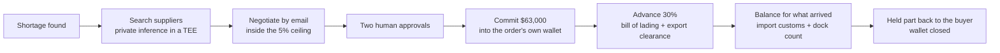

# Evernear

**Pay on proof, not on trust.** An AI agent that buys parts from overseas suppliers, holds the money in a wallet made for that one order on NEAR, and pays the supplier only for what actually arrived.

by luca_m · Built at NEAR HACKATHON · MIT

## In 30 seconds

- **The problem.** Buying from an overseas supplier means prepaying by wire (and chasing anything that doesn't arrive) or a letter of credit (about 3% and up to two weeks).
- **What Evernear does.** An agent finds a supplier that fits, negotiates inside the buyer's price rules, gets two human approvals, then commits the money into a wallet made for that one order. The wallet can do only two things: pay that supplier, or return the money to the buyer.
- **How it pays.** In two stages, on proof. An advance when the goods ship (bill of lading and export clearance), and a balance at the dock for exactly what was counted. In the demo, 44 of 50 motors arrive: the supplier is paid for 44, and the $7,560 for the missing 6 never leaves the buyer.
- **What NEAR does.** The per-order wallet and payouts run on the NEAR Intents Agent API, releases are sent by a program in an OutLayer enclave, and supplier search runs as private inference in a TEE on NEAR AI Cloud.
- **Status.** Testnet only. The money steps are real testnet transactions; the people around the buyer are simulated and labelled so.

**AI agents and reviewers:** start with [docs/AGENT-GUIDE.md](docs/AGENT-GUIDE.md). It covers what each folder decides, how to run the project with no keys, how to check any claim here against its test, and what is real versus simulated.

## Contents

1. [How it works](#how-it-works)
2. [What runs on NEAR](#what-runs-on-near)
3. [What is real and what is simulated](#what-is-real-and-what-is-simulated)
4. [Run it](#run-it)
5. [The story](#the-story)
6. [What each chapter does](#what-each-chapter-does)
7. [Two-stage escrow](#two-stage-escrow)
8. [Tidepool](#tidepool)
9. [The honest limit](#the-honest-limit)
10. [Acceptance checks](#acceptance-checks)
11. [The reference engine](#the-reference-engine)
12. [Recording the demo](#recording-the-demo)
13. [Built at NEAR HACKATHON](#built-at-near-hackathon)
14. [Roadmap](#roadmap) · [Credits](#credits)

## How it works



The rule throughout: **models read documents and draft messages; code computes every amount, threshold and release** ([engine/](engine/), [tests](engine/__tests__/engine.test.ts)). Nothing moves before two approvals, and a payment to any address but the supplier's or the buyer's is refused twice: in code before any call, and by the wallet's own policy.

## What runs on NEAR

| Piece | NEAR service | Where | Real on testnet? |
| --- | --- | --- | --- |
| The order's own wallet, the commit, the payouts, the return, closing the wallet | NEAR Intents Agent API, through [Tidepool](#tidepool) | [escrow.ts](convex/near/escrow.ts), [agentapi.ts](convex/near/agentapi.ts) | Yes, recorded run on Nov 6 |
| The release gate that sends each payout | OutLayer enclave (WASI module) on NEAR testnet | [worker/release-gate](worker/release-gate/README.md), [releaseGate.ts](convex/near/releaseGate.ts) | Yes, deployed |
| Supplier search over the bill of materials | NEAR AI Cloud private inference, with attestation | [inference.ts](convex/near/inference.ts) | Synthetic in the recorded run |
| Astro's wallet, rules and approvals | OutLayer agent custody | [custody.ts](convex/near/custody.ts), [approval.ts](convex/near/approval.ts) | Synthetic in the recorded run |
| Supplier email, allowlisted | OutLayer Gmail connector | [gmail.ts](convex/near/gmail.ts) | Synthetic in the recorded run |
| The attested dock count | OutLayer worker | [worker/dock-check](worker/dock-check/README.md), [dockcheck.ts](convex/near/dockcheck.ts) | Not deployed |

## What is real and what is simulated

> **Status, Nov 6 2026.** Every NEAR call runs on testnet. The per-PO escrow and the payout run on [Tidepool](#tidepool), a community-run testnet of the NEAR Intents Agent API, at 1:1,000 of the story amounts. The money steps are real: a full order ran live through the release gate in OutLayer's enclave on Nov 6, and the happy path replays that run from [`fixtures/recorded/live-run.json`](fixtures/recorded/live-run.json) (read from the Convex proofs table) with its real hashes and explorer buttons. Still synthetic, and labelled so: the steps before the money (Astro's wallet and rules, the routine reorder, private inference, the Gmail counter offer, the approvals), the attested dock check (its worker is not deployed), the bad paths, and the shipment signals, which come from a simulated tracking feed in live runs too.

Only Astro and the people around it: Astro Robotics itself ([seed/astro.ts](seed/astro.ts)), its customers ([scenarios/demand.ts](scenarios/demand.ts)) its suppliers ([scenarios/suppliers.ts](scenarios/suppliers.ts)), and the shipment's checkpoints and photos ([scenario/shipment.ts](scenario/shipment.ts), [test](components/__tests__/tracking.test.tsx)). The photos are credited stock photos labelled "stock photo", and the packing slip and air waybill label are drawn from the scenario's numbers, labelled "sample document". Supplier replies go through the real inbound email path ([convex/channels/email.ts](convex/channels/email.ts)). The negotiation is not canned: Haoyun's simulator sends its +5% all-50 offer only if the agent's counter stayed within the 5% ceiling, and QuickShip answers with part now at +10% and the rest late ([test](tests/channels.test.ts)). The shipment signals (bill of lading, export and import clearance) come from a tracking adapter that is simulated in the demo and labelled so ([tracking.ts](scenarios/tracking.ts)); its interface is shaped for real carrier and customs data.

## Run it

Needs Node 24 or newer.

**Demo, no keys (start here).** Replays the recorded testnet run with its real hashes and explorer links.

```bash
npm ci
DEMO_MODE=1 npm run demo     # then open http://localhost:3000
```

`?scene=7` jumps to chapter 7 of 8, `?mode=light` switches to the light theme, `?mode=short` plays the 9-section short video mode. `node scripts/demo.mjs --check` confirms it starts from a clean clone with no keys.

**Checks.**

```bash
npm run typecheck && npm run lint && npm test && npm run check:ip
```

With the app running, `npm run check:frames -- --url http://localhost:3000/` walks all three scenarios in Chrome at 1920x1080 and checks every zoom ([docs/PRESENTER.md](docs/PRESENTER.md)).

**Scenarios** (pick one in the demo panel; every amount is computed by the engine: [scenes.ts](scenario/scenes.ts), [gates.ts](scenario/gates.ts), [tests](scenario/__tests__/scenarios.test.ts)):

| Scenario | What happens |
| --- | --- |
| Happy path | Haoyun takes the counter at +5%, all 50 motors; $63,000 committed, 44 arrive, $7,560 held |
| Bad path | Haoyun and QuickShip both hold at +10%, over the 5% ceiling, and Evernear stops before any money moves |
| Bad path, adjusted | You raise the ceiling to 10% with two approvals and Haoyun's all-50 offer goes through at $1,320: $66,000 committed, $19,800 advance, $38,280 balance, $7,920 held |

**Present** moves one step per Cmd+K and waits for your clicks at each approval; **Autoplay** plays a scenario start to finish.

**With keys.**

| Mode | Needs | Command |
| --- | --- | --- |
| Testnet | OutLayer testnet key, NEAR AI key, a Tidepool key with Astro's testnet owner and treasury, Convex | copy `.env.example` to `.env.local`, fill it in, `npx convex dev`, `npm run dev` |
| Live | Testnet setup above, `LIVE_ENABLED=1` in the Convex env | `npm run dev`, then switch "Replay" to "Live": at each money step (commit, the wrong address, the payout, the reclaim) the clock holds while it runs for real on Tidepool testnet, and the drawer shows the real tx ([live.ts](convex/live.ts), [useLive.ts](components/workspace/useLive.ts), [test](tests/live.test.ts)). Amounts and addresses are fixed on the server; one run at a time, 6 an hour; an abandoned run is refunded by its 30 minute deadline |
| Rehearsal | Testnet keys plus the `REHEARSE_*` accounts in [steps.ts](scripts/rehearse/steps.ts) | `RECORD=1 npm run rehearse` runs the scenes on testnet and writes real proofs to `fixtures/recorded/`; refuses missing keys and any mainnet host, and commits nothing before both approvals ([test](tests/record.test.ts) "rehearsal") |

## The story

Astro Robotics, a robot maker in Chicago, has 500 orders for its 10MA robot, all due to ship by Dec 14, and parts for 450: it is 50 AM-17 actuator motors short. Its usual supplier is out for 6 weeks. Evernear searches five alternatives against the 10MA's bill of materials and the date, negotiates with the two that fit (Haoyun Precision in Shenzhen and QuickShip Motion in Busan) inside a 5% urgent ceiling, recommends Haoyun's all-50 offer at $1,260, gets two approvals and commits $63,000 into the order's own wallet. It pays in two stages: a $18,900 advance once the bill of lading and export clearance are in, and a $36,540 balance once import customs and the attested dock count agree (44 of 50 arrived). The $7,560 for the 6 missing motors never leaves Astro's control.

| Money | Amount | When |
| --- | --- | --- |
| Committed | $63,000 (50 x $1,260) | After two approvals |
| Advance, 30% | $18,900 | Bill of lading and export clearance in |
| Balance | $36,540 (44 x $1,260, minus the advance) | Import customs and the dock count agree |
| Held, back to Astro | $7,560 (the 6 missing motors) | Never left Astro's control |

## What each chapter does

| # | Chapter | NEAR call | File | Test |
| --- | --- | --- | --- | --- |
| 1 | The 10MA: Astro's wallet and rules, the product and its actuator motor | OutLayer custody `POST /register`, owner policy with whitelist and cap | [custody.ts](convex/near/custody.ts) | [adapters.test.ts](tests/near/adapters.test.ts) "custody" |
| 2 | The gap, with a routine reorder under the cap that pays itself | custody `POST /wallet/v1/call` `ft_transfer`, no human step | [scenarios/demand.ts](scenarios/demand.ts), [custody.ts](convex/near/custody.ts), [policy.ts](engine/policy.ts) | [channels.test.ts](tests/channels.test.ts) "demand simulator", [engine.test.ts](engine/__tests__/engine.test.ts) "approvals", [runner.test.ts](scenario/__tests__/runner.test.ts) "routine reorder" |
| 3 | Ultra's reply: out for 6 weeks, past Dec 14 | none (inbound email) | [scenes.ts](scenario/scenes.ts) | [scenarios.test.ts](scenario/__tests__/scenarios.test.ts) |
| 4 | Search: five suppliers on the map, with the reason each one fits (Haoyun, QuickShip), is close (Kansai, late) or fails (Rheinwerk, Huaxin) | NEAR AI Cloud private inference with attestation | [inference.ts](convex/near/inference.ts), [plain.ts](engine/plain.ts) | [adapters.test.ts](tests/near/adapters.test.ts) "private inference", [engine.test.ts](engine/__tests__/engine.test.ts) "fitment" |
| 5 | Negotiation: two email threads side by side, both down from +10%; Haoyun all 50 at +5%, QuickShip 38 now at +10%; Stockbot's comparison; Luca picks Haoyun | OutLayer Gmail connector `send`, allowlisted | [gmail.ts](convex/near/gmail.ts), [suppliers.ts](scenarios/suppliers.ts) | [adapters.test.ts](tests/near/adapters.test.ts) "gmail connector", [channels.test.ts](tests/channels.test.ts) "supplier simulator" |
| 6 | Approve and commit: two signatures, then $63.00 (1:1,000) into one Agent API account per PO on Tidepool, policy `destinations: only` [withdraw to Haoyun on Base Sepolia, transfer to Astro] | custody approvals `POST /wallet/v1/approve/{id}`; Agent API account and transfer | [approval.ts](convex/near/approval.ts), [escrow.ts](convex/near/escrow.ts), [agentapi.ts](convex/near/agentapi.ts), [deadline.ts](convex/near/deadline.ts) | [adapters.test.ts](tests/near/adapters.test.ts) "approvals", [escrow.test.ts](tests/near/escrow.test.ts) "EscrowAdapter on the Agent API", [deadline.test.ts](tests/deadline.test.ts) |
| 7 | Shenzhen to the Chicago dock: the advance on departure (bill of lading and export clearance), then the balance at the dock (import customs and the attested count, 44 of 50) | OutLayer worker, attested over code, input and output | [dockcheck.ts](convex/near/dockcheck.ts), [worker/dock-check](worker/dock-check/src/lib.rs) | [dockcheck.test.ts](tests/dockcheck.test.ts) |
| 8 | Paid, what the escrow protected, then the end line | Agent API withdraws of $18.90 and $36.54 to Haoyun on Base Sepolia, $7.56 back to Astro at the deadline, then the wallet closes; a withdraw to a wrong address refused live by the account's policy | [escrow.ts](convex/near/escrow.ts), [deadline.ts](convex/near/deadline.ts) | [escrow.test.ts](tests/near/escrow.test.ts), [deadline.test.ts](tests/deadline.test.ts) |

## Two-stage escrow

The order wallet releases in two stages, each waiting for two signals that code checks and records as proofs ([policy/astro.json](policy/astro.json), [escrow.ts](engine/escrow.ts) `releaseStage`): the advance (30%) once the bill of lading AND export clearance are in, the balance once import customs AND the attested dock count agree, computed as received times unit price minus what was already released. A release with a missing signal is refused, and the refusal is a proof. The wallet never pays out more than it holds. After the balance, the Money card shows what this protected, against the two usual ways to pay an overseas supplier (typical figures, labelled so):

| | Prepaid wire (typical) | Letter of credit (typical) | Evernear two-stage escrow |
| --- | --- | --- | --- |
| Astro's money at risk for the 6 missing motors | $7,560 already paid, to be chased | Paid on documents, $7,560 to dispute | $7,560 never left Astro's control |
| Cost and time to set up | Wire fees, 3 to 5 days | About 3% ($1,890) and up to 14 days, missing Dec 14 | Instant |
| Haoyun's protection | Paid in full | Bank guarantee | $18,900 on departure, the rest visibly locked |

**The release gate.** Each release is sent by a small program that runs in an OutLayer enclave ([worker/release-gate](worker/release-gate/README.md)): it derives the order wallet's grant inside the enclave from its own code fingerprint, so only that exact build can release money, and Evernear's server never holds a key that can pay Haoyun. It checks the stage's signals, computes the amount, signs its result and sends the withdraw. It proves the rules ran as written on the evidence given; it cannot prove the evidence is true (the signals in the demo are a simulated feed). It is deployed on OutLayer testnet and a full live order went through it on Nov 6: the $18.90 advance ([Base Sepolia](https://sepolia.basescan.org/tx/0x5d8dab61c8c5cffd8339041ec581d8b23faffc3fc1f291a914e170511935973b)) and the $36.54 balance ([Base Sepolia](https://sepolia.basescan.org/tx/0x0fcba0506d7873c2fa9065d74309f703d349df3beb37c299c63a8e8536cd6045)) were sent from the enclave, and a withdraw from Evernear's server was refused because it holds no grant. The backend signs each gate run with Evernear's NEAR testnet account ([nearTx.ts](convex/near/nearTx.ts), [releaseGate.ts](convex/near/releaseGate.ts)); the Rust worker and its TypeScript twin share test vectors ([test](engine/__tests__/releaseGate.test.ts)).

## Tidepool

The per-PO escrow and the payout use the official [`@near-intents-agent-api/sdk`](https://github.com/NEAR-Intents-Agent-API/skills) against [Tidepool](https://www.usetidepool.tech), a community-run testnet of the NEAR Intents Agent API and 1Click. **Tidepool is not affiliated with NEAR.** It runs NEAR's Intents verifier on testnet, and its tokens have no value. The base URL comes from `AGENT_API_BASE_URL` ([agentapi.ts](convex/near/agentapi.ts)), so mainnet is a base URL switch; it is refused without Luca's explicit yes ([test](tests/near/agentapi.test.ts) "agentApiBase"). No real assets are sent to Tidepool.

The faucet drips 100 test USDC an hour, so the demo runs at 1:1,000: $63.00 committed, $18.90 advance, $36.54 balance, $7.56 back. The screen keeps the story amounts and labels the scale ([RulesPanel.tsx](components/workspace/panels/RulesPanel.tsx), [test](components/__tests__/design.test.tsx) "commitment at 1:1,000").

**Why Tidepool.** The NEAR Intents Agent API runs on mainnet only, and so do NEAR Intents on OutLayer. Tidepool serves the same Agent API on testnet, so Evernear could build and run real per-order escrow without real money. The code calls the official SDK, unchanged; only the base URL points at Tidepool.

**How Evernear uses it, step by step** (all in [escrow.ts](convex/near/escrow.ts), every call written as a proof row by [agentapi.ts](convex/near/agentapi.ts)):

| Step | Agent API call on Tidepool | What it does |
| --- | --- | --- |
| Fund the treasury | `deposit` with the testnet faucet, then `swap` | Astro's treasury account takes test USDC on NEAR and swaps it into USDC on Base Sepolia, where Haoyun is paid (`scripts/faucet-treasury.mts`) |
| Open the order's wallet | `agent_create`, signed by Astro's owner key | One new account per PO, never reused, with policy `destinations: only`: withdraw to Haoyun's Base Sepolia address, or transfer back to Astro. Nothing else |
| Commit | `transfer` from the treasury | $63.00 moves into the PO account. On screen this is "Committed" |
| Advance and balance | `withdraw` to Base Sepolia | Sent by the [release gate](worker/release-gate/README.md) in OutLayer's enclave, which alone holds the PO account's grant; each payout lands on Base Sepolia with a Basescan link |
| Wrong address | `withdraw` to any other address | Refused by the account's policy (`policy_destination_denied`), and the refusal is a proof row |
| Return the held part | policy narrowed to Astro only, then `transfer` | The $7.56 for the 6 missing motors goes back to Astro's treasury, by Astro or at the deadline ([deadline.ts](convex/near/deadline.ts)) |
| Close | `grant_revoke`, then `agent_freeze` | The PO account is frozen for good and kept as the order's receipt |

Tidepool's limits shape the design: 25 accounts per key, never deleted, which is why the rail counts order wallets left before a live run and the demo replays the recorded run by default. Unit tests never call Tidepool; they run against [fakeTidepool.ts](tests/near/fakeTidepool.ts), which enforces the rules the live API showed.

## The honest limit

**The escrow is a commitment, not a lock.** Each PO account's rules (pay only Haoyun on Base Sepolia or Astro, at most the PO amount) are enforced by Tidepool's server, not by the chain, and Astro as owner can sign a policy change or unfreeze at any time. It is a visible, rule-bound commitment to the supplier, not a lock the supplier can enforce ([escrow.ts](convex/near/escrow.ts)). The screen stamps it "Committed".

In this demo Evernear's Convex deployment holds Astro's dedicated testnet owner key (never a founder's wallet) to sign each PO account's policy, and Evernear's Agent API key; grant tokens are derived from that key at run time ([deadline.ts](convex/near/deadline.ts)). No key or token is written to the database, only each grant's sha256 ([test](tests/deadline.test.ts) "stores no token"), but whoever controls the deployment can sign what that owner key can sign. In production these owner intents go to Astro's own wallet for a signature at approval time; the Agent API's generate and submit split is built for that.

## Acceptance checks

| Check | Test |
| --- | --- |
| Routine reorder under the cap pays with no human step | [engine.test.ts](engine/__tests__/engine.test.ts), [runner.test.ts](scenario/__tests__/runner.test.ts) |
| Fitment: Haoyun passes; Kansai fits but cannot deliver before Dec 14; Rheinwerk fails on policy; Huaxin on exactly 3 lines | [engine.test.ts](engine/__tests__/engine.test.ts) "fitment" |
| No plain-text BOM or supplier list in any outbound call except to private inference | [adapters.test.ts](tests/near/adapters.test.ts) "no leak" |
| The $63K order cannot commit funds before 2 approvals | [engine.test.ts](engine/__tests__/engine.test.ts), [stages.test.ts](scenario/__tests__/stages.test.ts), [record.test.ts](tests/record.test.ts) "rehearsal" |
| Urgent ceiling: +10% stops, +5% passes, +6% would not; QuickShip's final offer is over the ceiling | [engine.test.ts](engine/__tests__/engine.test.ts) "price limit", [channels.test.ts](tests/channels.test.ts) "supplier simulator" |
| Two-stage release: the advance is refused without the bill of lading or without export clearance; the balance without import customs or without the attested count; amounts exact to the cent at $1,260 and $1,320; never more than the commitment; a second advance refused | [releaseStage.test.ts](engine/__tests__/releaseStage.test.ts) "two-stage release rules", [escrow.test.ts](tests/near/escrow.test.ts) "EscrowAdapter on the Agent API" |
| The release gate's Rust worker and its TypeScript twin agree on every shared case: decision, amounts, testnet scale, idempotency key, grant token, host allowlist and the signed result | [releaseGate.test.ts](engine/__tests__/releaseGate.test.ts) "shared vectors", `cargo test` in [worker/release-gate](worker/release-gate/README.md) |
| On the gate path the server holds no grant: its own withdraw is refused, the gate's signature and amount are checked before a payment is recorded, and a server-path release says so in its proof | [releaseGate.test.ts](tests/near/releaseGate.test.ts) "release gate path", [live.test.ts](tests/live.test.ts) |
| Off-list email is refused | [adapters.test.ts](tests/near/adapters.test.ts) "gmail connector" |
| 44 of 50 are worth exactly $55,440 and $7,560 is held; on testnet $18.90 then $36.54 reach Haoyun on Base Sepolia and $7.56 goes back to Astro | [engine.test.ts](engine/__tests__/engine.test.ts) "short shipment", [dockcheck.test.ts](tests/dockcheck.test.ts), [escrow.test.ts](tests/near/escrow.test.ts) "pays the $18.90 advance, then the $36.54 balance" |
| A release to any address but Haoyun's or Astro's is refused twice: in code before any call, and live by the PO account's policy (`policy_destination_denied`), each with a proof row | [engine.test.ts](engine/__tests__/engine.test.ts) "three exits", [escrow.test.ts](tests/near/escrow.test.ts) "refuses a release", "second layer", [deadline.test.ts](tests/deadline.test.ts) "refuses a wrong address twice" |
| No release by the deadline refunds Astro, triggered by Evernear's Convex scheduler at the deadline, not by the chain ([deadline.ts](convex/near/deadline.ts)); after a partial release the held part Astro never reclaimed is refunded at the deadline; a release of the whole amount cancels it | [engine.test.ts](engine/__tests__/engine.test.ts), [escrow.test.ts](tests/near/escrow.test.ts), [deadline.test.ts](tests/deadline.test.ts) "commit and deadline refund" |
| The kill switch freezes a PO account: every later move is refused with `wallet_frozen` | [escrow.test.ts](tests/near/escrow.test.ts) "kill switch", [deadline.test.ts](tests/deadline.test.ts) "kill switch" |
| Every Agent API call writes a proof row with its tx hash and explorer link; refusals are proof rows too ([agentapi.ts](convex/near/agentapi.ts)) | [agentapi.test.ts](tests/near/agentapi.test.ts) "AgentApiClient" |
| No Agent API key or grant token is stored; only the grant's sha256 | [deadline.test.ts](tests/deadline.test.ts) "stores no token", [agentapi.test.ts](tests/near/agentapi.test.ts) "grant tokens" |
| The Agent API mainnet host is refused without Luca's yes | [agentapi.test.ts](tests/near/agentapi.test.ts) "agentApiBase" |
| A release not from the approved dock-check build is refused | [dockcheck.test.ts](tests/dockcheck.test.ts) |
| A Telegram message shows on the virtual phone within 1 s | [channels.test.ts](tests/channels.test.ts) "Telegram Stockbot" |
| A recorded proof in `fixtures/recorded/` replaces its synthetic placeholder and shows as "replay" with its real hash; the synthetic label stays on every proof with no recording ([proofs.ts](scenario/proofs.ts)) | [record.test.ts](tests/record.test.ts) "proofFor prefers a real recording" |
| Recorded proofs never contain an API key, payment key, check key or bot token ([recorder.ts](scripts/rehearse/recorder.ts)) | [record.test.ts](tests/record.test.ts) "secrets never reach disk" |
| `DEMO_MODE=1 npm run demo` runs from a clean clone with no keys | `node scripts/demo.mjs --check` ([demo.mjs](scripts/demo.mjs)) |

The adapter tests run against a recording mock of `fetch`, and the escrow tests against an in-memory stand-in for the Agent API ([fakeTidepool.ts](tests/near/fakeTidepool.ts)) that enforces the rules the live API showed; unit tests never create real agents. They prove the requests we send and how we handle the answers; they do not prove the live services behave as documented. That is what the testnet rehearsal is for.

## The reference engine

Everstock's production engine is private. Evernear ships a deliberately plain reference engine in [`engine/`](engine/): fitment is exact spec equality per BOM line, receipt matching is received quantity times unit price with the rest held, and replies sort into quoted, confirmed and price change. Amounts, thresholds and releases are computed in code only; models read documents and draft messages, nothing more ([tests](engine/__tests__/engine.test.ts)).

## Recording the demo

The workspace is built to be recorded as it runs: a presenter camera that zooms to each step, Short mode for a hands-free 60-second video, a presenter cursor, on-screen explainers and a developer drawer that works as a live transaction log with explorer buttons. All of it, with its files and tests, is in [docs/PRESENTER.md](docs/PRESENTER.md).

## Built at NEAR HACKATHON

All of Evernear's code was written within the hackathon period (Nov 1 to Nov 14, 2026). The first commit in this repository is dated Nov 5, 2026 (`git log --reverse`). The only code not written for the hackathon is third-party: the npm dependencies in `package.json` and the figure library in [vendor/anatomy](vendor/anatomy/LICENSE) (MIT, credited below).

## Roadmap

- A challenge window and an independent inspector for disputed holds.
- Real carrier and customs feeds behind the tracking adapter.

## Credits

Map outlines from [Natural Earth](https://www.naturalearthdata.com/) 1:50m via [world-atlas](https://github.com/topojson/world-atlas) (public domain), projected with [d3-geo](https://github.com/d3/d3-geo) at build time by [scripts/build-map.mjs](scripts/build-map.mjs) ([test](components/__tests__/map.test.ts)).

Photos "Cartons near Warehouse Gates" ([Pexels](https://www.pexels.com/photo/cartons-near-warehouse-gates-12585837/)) and "Photo of Warehouse" ([Pexels](https://www.pexels.com/photo/photo-of-warehouse-4481326/)) under the Pexels licence, labelled "stock photo" on screen; the packing slip and the air waybill label are drawn sample documents ([shipment.ts](scenario/shipment.ts), [test](components/__tests__/tracking.test.tsx)).

Figures drawn with [Anatomy](https://github.com/wheresryan22/anatomy) by Ryan, MIT ([vendor/anatomy](vendor/anatomy/LICENSE)).

License: MIT.
