# Recording the demo

How the Evernear workspace is built to be recorded: the presenter camera, Short mode, the presenter cursor, the on-screen explainers and the developer drawer. Back to the [README](../README.md).

## Presenter camera

Record with any screen recorder and the zooms are already in the video. Each named step in the story can carry a focus (an element's `data-focus` id, a zoom from 1.0 to 2.5, a hold, an optional spotlight that dims the rest to 40%). When the step runs, everything but the demo rail pans and scales in one CSS transform so the element sits in the middle, holds, then eases back to the full view unless the next step has its own focus: 700 ms in, 500 ms out, a spring with no more than 2% overshoot. The layout is scaled, not a bitmap, so text stays crisp. **F** turns the camera on or off, **Z** follows your clicks (1.4x toward each click, back after 2 s without one), **0** returns to the full view, **C** turns the presenter cursor on or off, and the right arrow plays the next step and its zoom. With the reduced motion setting the moves are cuts. Open `/present` in a second window of the same browser for a remote that shows the current focus and can preview or skip the next zoom. Focus plan and maths: [scenes.ts](../scenario/scenes.ts), [camera.ts](../scenario/camera.ts), [Camera.tsx](../components/workspace/Camera.tsx), [Remote.tsx](../components/workspace/Remote.tsx). Tests: [camera.test.ts](../scenario/__tests__/camera.test.ts) (targeting, spring, the 18-step plan), [camera.test.tsx](../components/__tests__/camera.test.tsx) (hold, return, reduced motion), [focus.test.tsx](../components/__tests__/focus.test.tsx) (every focus id exists in the DOM for its chapter, in all three scenarios).

| Chapter | Step | Focus | Zoom |
| --- | --- | --- | --- |
| 1 | Product switch | `products.figure` | 1.5x |
| 1 | Motor highlight | `products.motor` | 2.2x |
| 2 | The gap | `stock.shortfall` | 1.8x |
| 3 | Ultra's reply | `inbox.reply` | 1.7x |
| 4 | Search typed (the query and "Comparing suppliers: 0 of 5") | `map.search` | 1.8x |
| 4 | Private inference (explainer) | `developer.attestation` | 1.5x |
| 4 | Attestation (explainer) | `developer.attestation` | 1.8x |
| 4 | Pins resolve (the map fills its card, so this frames the whole map) | `map.results` | 1.4x asked, about 1.0x fitted |
| 4 | Orange reasons (spotlight on Kansai's pin) | `map.results.partial` | 2.0x |
| 5 | Offers side by side | `negotiation.threads` | 1.3x |
| 5 | Haoyun's offer | `negotiation.haoyun` | 1.9x asked, fitted to the thread |
| 5 | Recommendation | `negotiation.compare` | 1.6x asked, fitted to the card |
| 6 | Approvals | `rules.approvals` | 1.8x |
| 6 | Funds move | `money.escrow` | 2.0x |
| 6 | Order wallet (explainer) | `developer.policy` | 1.6x |
| 7 | Dock count | `dock.count` | 2.0x |
| 7 | Signed result (explainer) | `developer.signed` | 1.7x |
| 8 | Paid and refused | `money.payout` | 1.8x |
| 8 | Wallet lifecycle (explainer) | `money.lifecycle` | 1.6x |

### Every zoom shows its card in full

Each step with a focus declares what its frame must show (`shows` in [scenes.ts](../scenario/scenes.ts): text such as "Committed for PO 1042"). The camera waits until the focused element holds all of it, measures two frames later so the card has laid out, zooms so the whole element fits with 48 px around it, and measures again when the move lands, correcting the frame if the content grew ([Camera.tsx](../components/workspace/Camera.tsx)). Nothing in a focused element is cut with an ellipsis; hashes and addresses shortened on purpose carry `data-abbr` and their full value on hover. Tests: [frames.test.tsx](../components/__tests__/frames.test.tsx) (in all three scenarios every zoom declares what it shows, the element holds all of it at its step, no cut text; and over 2,000 random elements the camera's frame keeps each one inside the viewport with padding), [camera.test.tsx](../components/__tests__/camera.test.tsx) (it waits for the declared text). In a real browser, [check-frames.mjs](../scripts/check-frames.mjs) checks with layout that each zoomed element is inside the 1920x1080 viewport, that no box inside it cuts its text, that every declared text is on screen and not scrolled away, and lists cut text on the other cards; the last run passed all 22 zooms of the happy path, 11 of the bad path and 21 of the adjusted path, with no cut text on any card.

What changed so no step talks over an empty card:

- Chapter 1: Astro's wallet is on the Money card from the first frame. In Live the wallet says Connecting until the Tidepool key answers, then Connected with the treasury's balance.
- The steps in a chapter's first 1.6 s play with the press that enters the chapter (`rides`, [scenes.ts](../scenario/scenes.ts) `buildTimeline`): entering chapter 2 shows the gap, chapter 3 delivers Ultra's reply, chapter 4 runs the search, chapter 5 lands both quotes in their threads, chapter 6 sends the approval card, chapter 8 tries the lookalike payment. A human moment always waits for its own press.
- Chapter 2: the gap's zoom frames the headline and the chart together.
- Chapter 4: the map has the card to itself and fills it. While the search runs, "Comparing suppliers: 0 of 5" counts up; each supplier's pin appears as it is checked, with its name and one line of why in green, orange or crimson (fits, late, missing parts, fails policy; the exact failing specs on hover); "2 fit, 1 late, 2 fail" when it is done. No supplier pins before the search.
- Chapter 5: the Inbox has the room beside the phone. Every email in both threads shows in full; the threads are as tall as their emails and scroll on their own only if they outgrow the card; a new email scrolls its thread to it and is lit for 4.5 s; Stockbot's comparison is a full-width card under both threads.
- The drawer's explainer column grows to fit and wraps long values instead of cutting them.
- An explainer (the attestation, the signed result, the wallet lifecycle) stays open and zoomed until your next press; it closes with the step that press plays, never while the clock runs between stops. Test: [gates.test.ts](../scenario/__tests__/gates.test.ts) "explainers stay up while you talk".
- Live (chapters 6 to 8): while a money step runs, the Money card says what is happening ("Committing $63.00 on Tidepool testnet") and the drawer opens on the entry, which shows Confirming, then its View on NearBlocks or View on Basescan button. Cmd+K does nothing until the step is confirmed, and a press while the clock is still on its way stops at the step instead of passing it. Tests: [liveStatus.test.tsx](../components/__tests__/liveStatus.test.tsx), [liveGate.test.tsx](../components/__tests__/liveGate.test.tsx).

Cmd+K presses per chapter, from the browser run (the page opens on chapter 1):

| Scenario | 1 | 2 | 3 | 4 | 5 | 6 | 7 | 8 | 9 | Total |
| --- | --- | --- | --- | --- | --- | --- | --- | --- | --- | --- |
| Happy path | 2 | 1 | 3 | 5 | 11 | 6 | 8 | 5 | | 41 (was 49) |
| Bad path | 2 | 1 | 3 | 5 | 9 | 2 | | | | 22 |
| Bad path, adjusted | 2 | 1 | 3 | 5 | 9 | 7 | 6 | 8 | 5 | 46 |

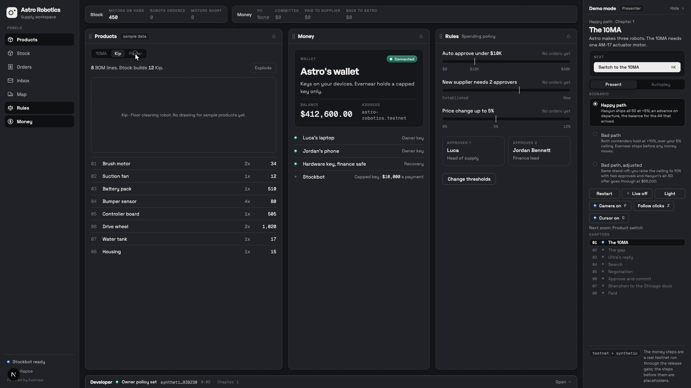
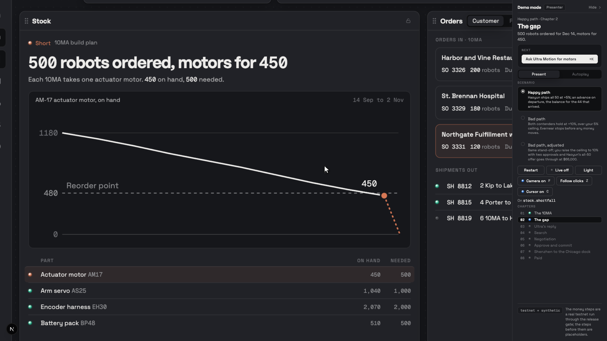
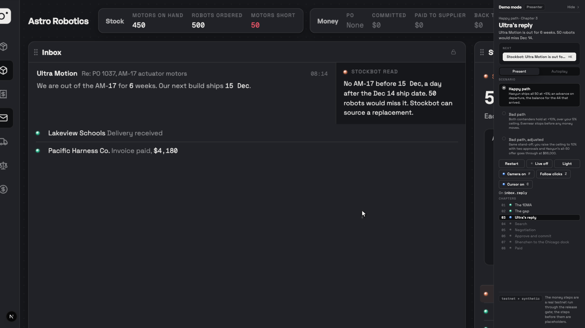
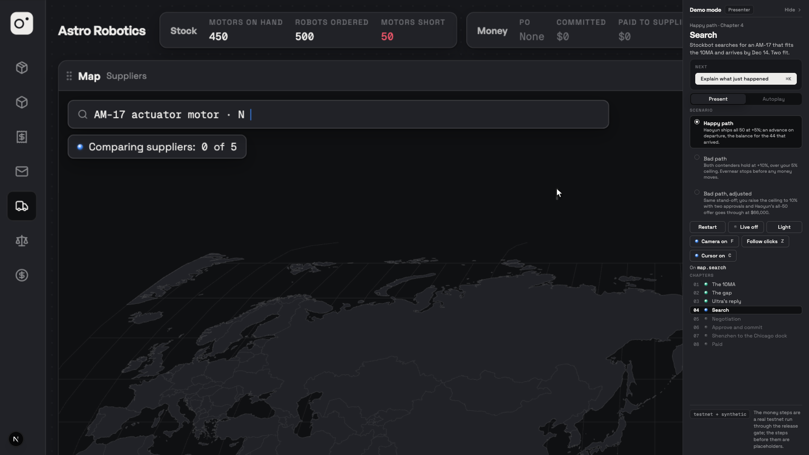
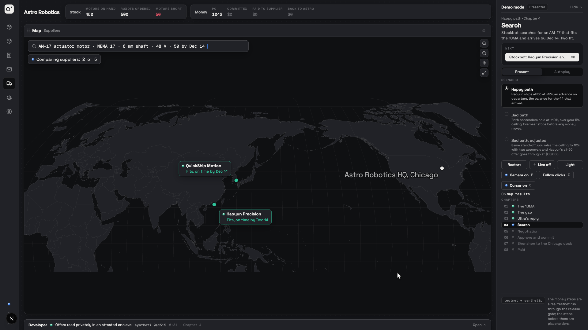
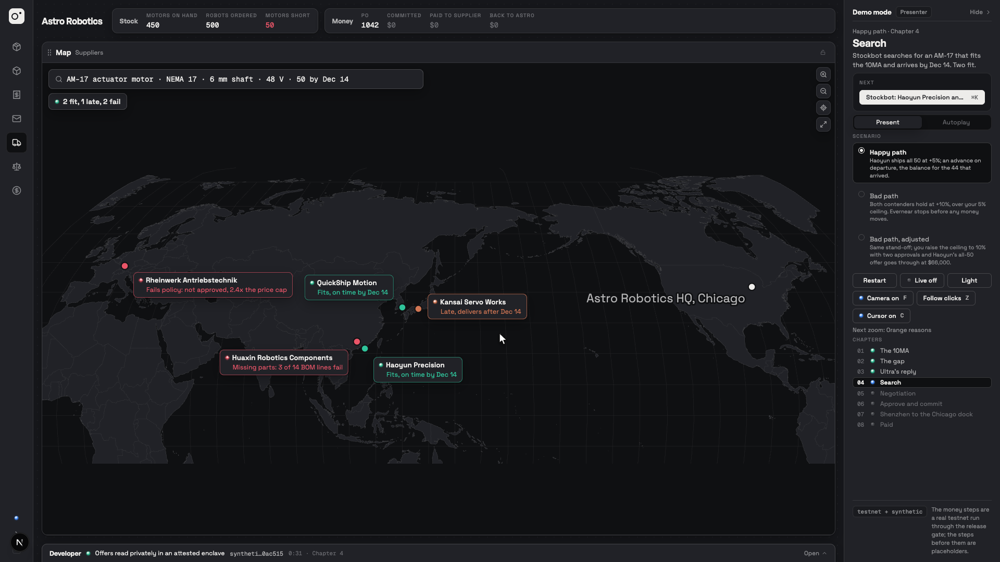
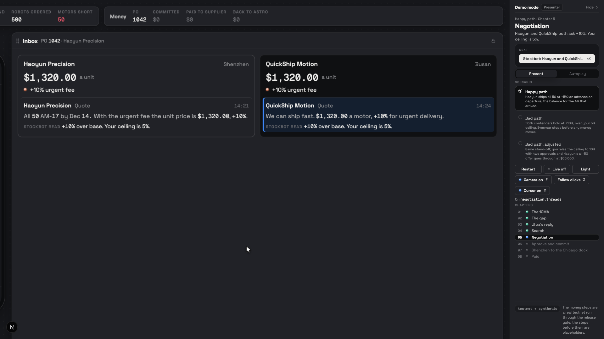
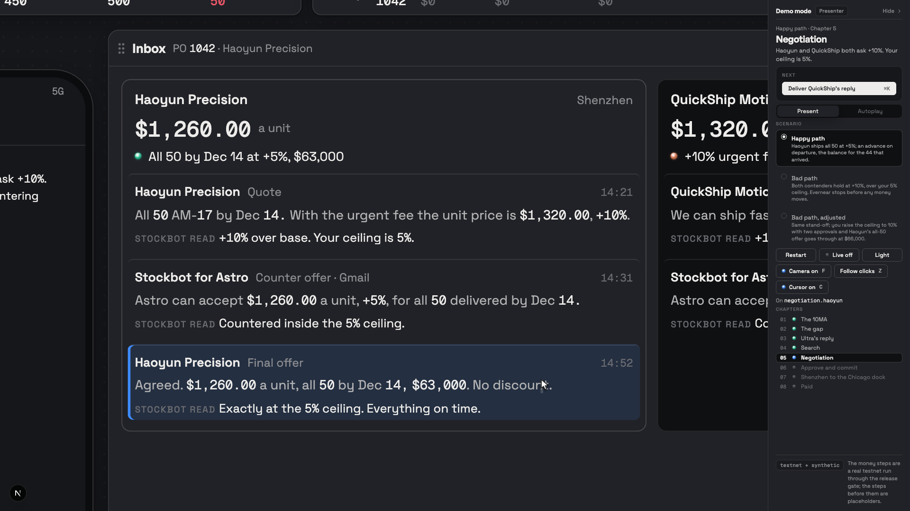
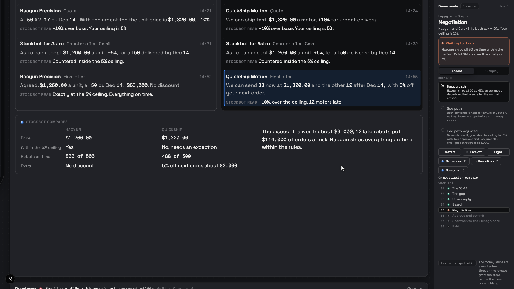
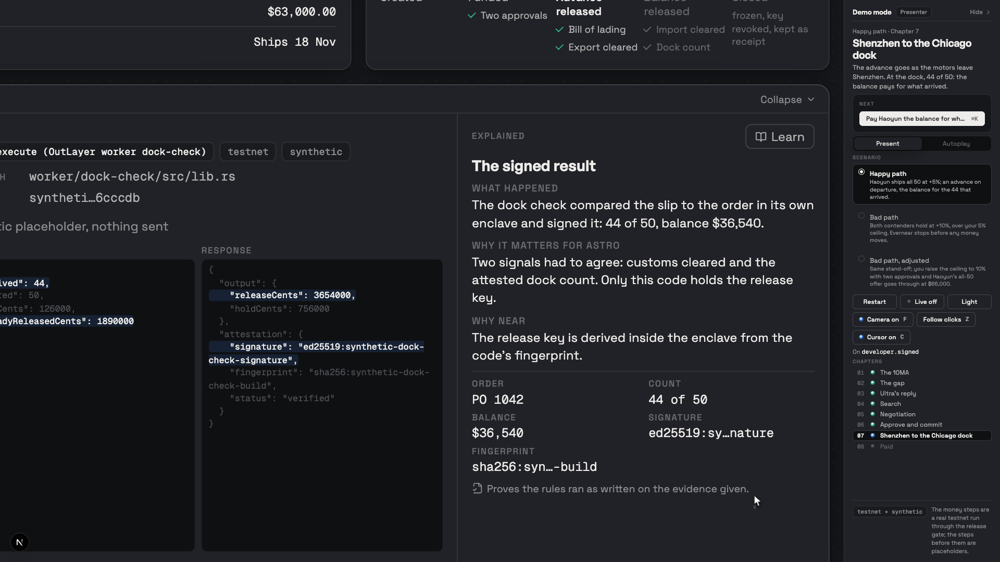

### Short mode

For a short video recorded hands-free, **Short** in the demo panel (or `?mode=short` in the URL) plays the happy path as 9 sections by itself. One press of Play (or Cmd+K) starts the run: the starting view (Astro Robotics with the 10MA on screen) holds for an 8 s hook, then each section plays its animation, with the presenter cursor doing the taps (the 10MA tab, Start sourcing, Choose Haoyun, both YES approvals, the packing slip) and the zooms timed inside it, holds on its final frame until its speaking time is up, pauses 2.5 s, and the next starts on its own. Speaking times: the company 8 s, the gap 9 s, search 13 s, negotiation 11 s, approve and commit 12 s, ship and dock 9 s, paid 7 s, on chain 9 s, end frame 4 s, then the end frame holds 14 s for the outro and the run stops: 124 s in all. They live in one table, `TIMING` in [short.ts](../scenario/short.ts); `?pace=` scales the talking times and `?gap=` sets the pause in seconds. Space pauses and resumes; Cmd+K skips to the next section; the left arrow replays the current one. Nothing on the recorded screen counts down; the `/present` remote shows "Section N of 9", the time left in it and the next section's name. Live is always off, and the drawer replays the recorded testnet run, so "On chain" holds the drawer on the commit with its real hash and its View on NearBlocks button. The Money card's badges show the story's own dates ([storyDates.ts](../scenario/storyDates.ts): committed 3 Nov 14:58 after the approvals, advance 7 Nov 01:40 at departure, paid 11 Nov 08:42 at the dock); the drawer keeps the real timestamps. While an explainer's proof is a synthetic placeholder, the drawer shows only the Explained column and its diagram ([Drawer.tsx](../components/workspace/Drawer.tsx)). The search map places its labels so none overlaps ([labels.ts](../components/workspace/map/labels.ts)). Tests: [short.test.ts](../scenario/__tests__/short.test.ts) (the table, the run's length, the hook, pace and gap, every tap reachable, the run replays the happy path), [short.test.tsx](../components/__tests__/short.test.tsx) (nothing before Play, the whole run with no presses at the table's length, Space, Cmd+K, no countdown on screen, the remote, every zoom target, the explainer alone, the badge dates), [shortLive.test.tsx](../components/__tests__/shortLive.test.tsx) (Live cannot turn on), [mapLabels.test.ts](../components/__tests__/mapLabels.test.ts) (no overlaps from a 900 to an 1800 px map). In a real browser: `node scripts/check-frames.mjs --scenario short --size 1440x900` ([check-frames.mjs](../scripts/check-frames.mjs)).

### Presenter cursor

So the video shows a cursor at work while you only press **Cmd+K** or the right arrow, Present mode draws its own cursor (a macOS arrow with a soft shadow). On a step that is a click in the app, it glides there in 450 to 700 ms, presses (a small press plus a ring), and only then does the change happen. On a step that only animates (a chart, the ship, a payment, a message) it never clicks; it rests beside the step's content. It moves inside the camera's transform, so it lands on the right spot at every zoom and keeps its size on screen. It only clicks elements inside the workspace, never the demo rail (Live, Restart, the scenario picker). While it is on, the system cursor is hidden over the workspace and comes back once the mouse moves more than 40 px; your next step from the keyboard hands control back to the cursor. Clicking a phone button yourself still works at once. **C** turns it on or off (on in Present, off in Autoplay; the demo rail shows it beside Camera). With reduced motion it jumps and still shows the ring. Rules: [cursor.ts](../scenario/cursor.ts), drawing and timers: [Cursor.tsx](../components/workspace/Cursor.tsx). Tests: [cursor.test.ts](../scenario/__tests__/cursor.test.ts) (glide times, which steps click, nothing forbidden), [cursor.test.tsx](../components/__tests__/cursor.test.tsx) (every click target exists in the DOM inside the camera just before its step, in all three scenarios; the waits are answered from Cmd+K with the press first; never the Live button).

| Chapter | Step | The cursor clicks |
| --- | --- | --- |
| 1 | Kip, Porter, then the 10MA | The product's tab (`products.tab.*`) |
| 3 | Start sourcing | The Inbox's Start sourcing button (`inbox.start`) |
| 5 | Choose Haoyun | The chip on the phone (`phone.tap`) |
| 6 | YES, approve as Luca; YES, approve as Jordan | YES on the phone's approval cards |
| 7 | Send packing slip photo | The button under the phone's chat |
| Bad paths | End the order; Raise to 10%; YES, approve as Jordan | The phone's chip or button |

## Evernear explains itself

Five moments explain the architecture on screen: the camera zooms to the panel, the developer drawer opens on the matching step, and its right column says what happened, why it matters for Astro and why NEAR, in under 25 words each, with figures from the engine. **Learn** swaps the three lines for a small diagram. The drawer's three columns answer three questions: **Steps** (what has happened, with an icon per kind), **Proof** (the call, network, code path, hash, then the request and response with the two or three fields that matter lit), **Explained** (what it means). Text in the opened drawer is at least 14px.

| Moment | Chapter | Proof | Diagram |
| --- | --- | --- | --- |
| Private inference in an enclave | 4 | NEAR AI Cloud private inference | Enclave |
| The attestation | 4 | the same call's attestation: signer, code fingerprint, verified | Attestation chain |
| The order's own wallet | 6 | the PO account: its two allowed destinations, the capped agent key, owner Astro | Order wallet |
| The signed result | 7 | the attested dock check: order, count, amount, signature, fingerprint ("Proves the rules ran as written on the evidence given.") | Signed result |
| Paid on their chain, then the wallet closes | 8 | the payout, then "Wallet closed" | Wallet lifecycle, also on the Money card |

Each order wallet serves one order and is never reused: once settled it is frozen, Evernear's grant is revoked, and it stays as the order's receipt; a closed wallet refuses every move ([escrow.ts](../engine/escrow.ts) `closeWallet`). Content and tests: [explain.ts](../scenario/explain.ts), [Drawer.tsx](../components/workspace/Drawer.tsx), [Diagrams.tsx](../components/workspace/Diagrams.tsx), [explain.test.ts](../scenario/__tests__/explain.test.ts).

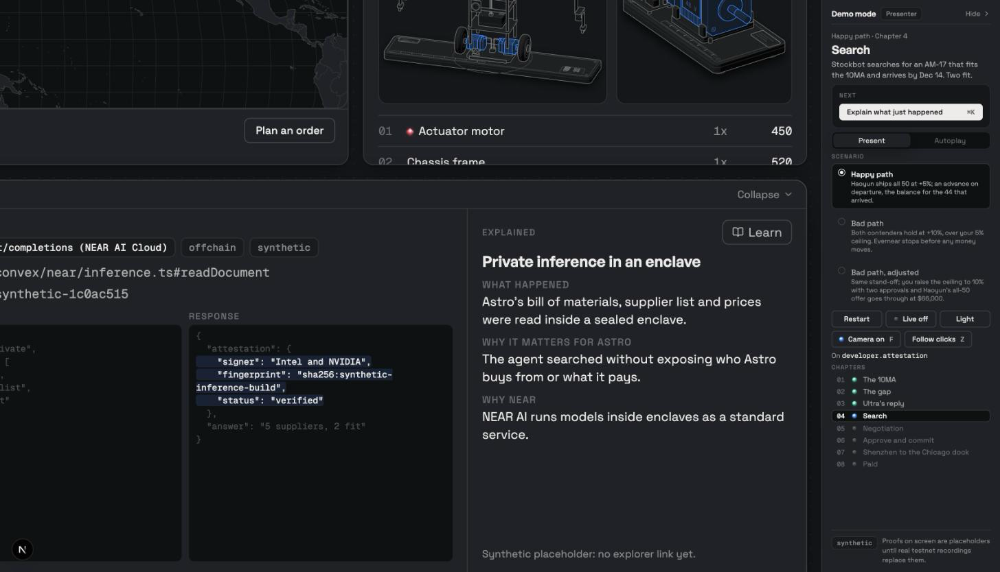
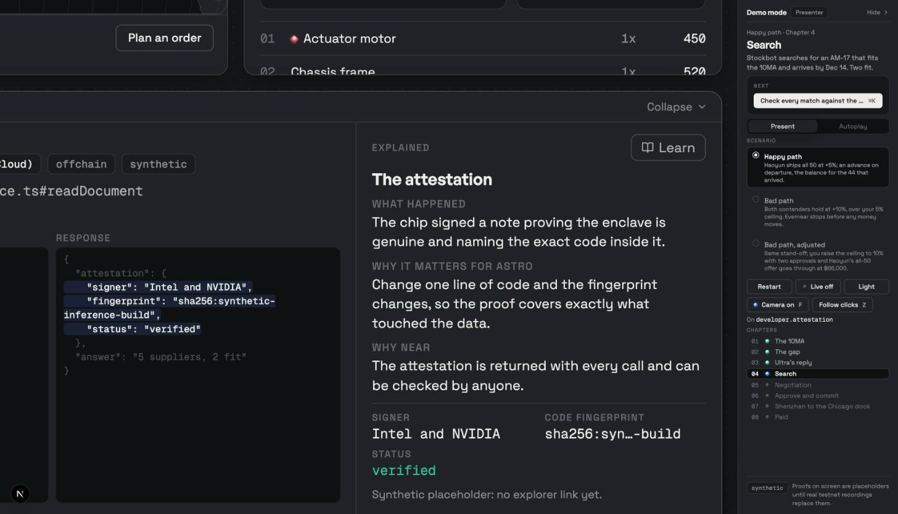
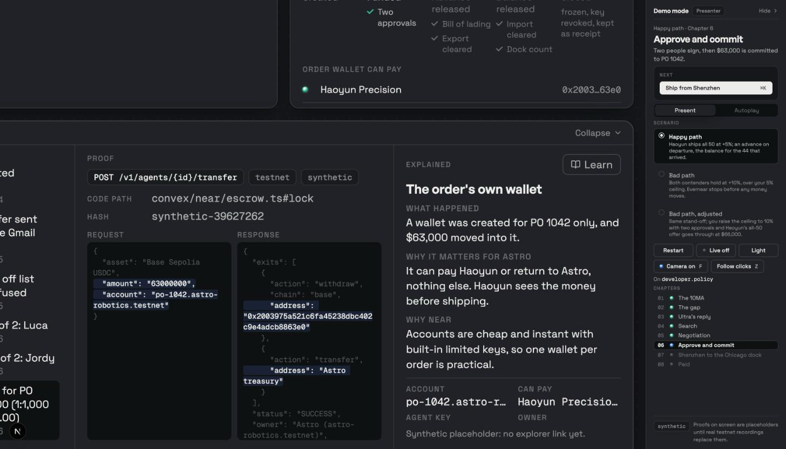
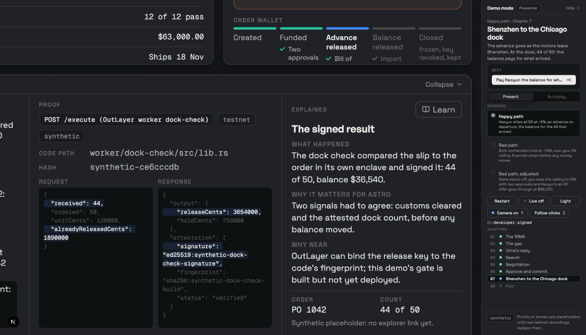
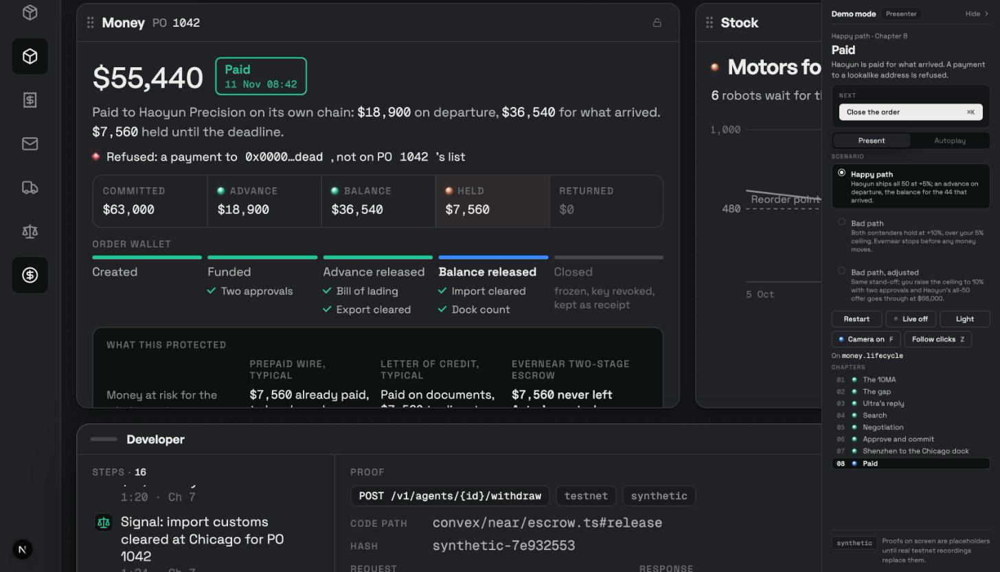

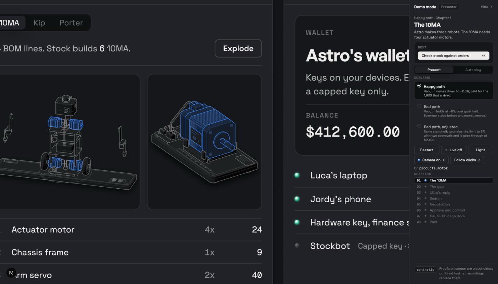
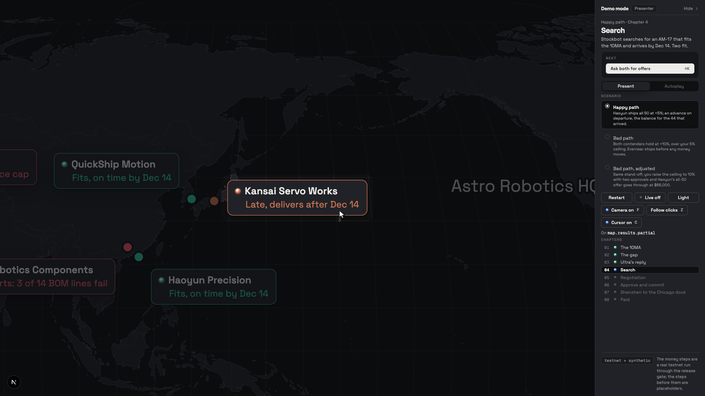
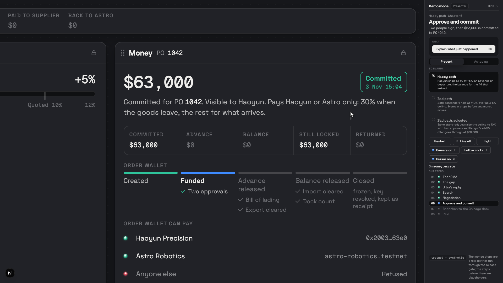

## The developer drawer as a transaction log

Record in Present mode with Live on and the drawer open: every real call appears in the drawer's Steps the moment it lands, in story order, with the time it ran, the story day (3 Nov commit, 5 Nov advance, 11 Nov balance, 11 Dec return) and the chapter. The commit, the advance, the refused wrong-address payment, the balance, the return to Astro and the wallet closing are all there, and each release gate run has its own entry before the payout it sent. Clicking an older entry opens its proof; "Follow the latest" goes back. The history stays for the whole run. Under each entry's title:

| Entry | Under the title |
| --- | --- |
| A payout on Base Sepolia | **View on Basescan** (sepolia.basescan.org/tx/...), with "Base Sepolia" and the short hash |
| A NEAR testnet transaction: a release gate run, the commit, the treasury swap, the return to Astro | **View on NearBlocks** (testnet.nearblocks.io/txns/...), with "NEAR testnet" and the short hash |
| A payout whose hash is not known yet | **Confirming**, not a link, until the hash lands |
| A Tidepool step with no public chain (account policy, grants, freeze, wallet closed) | "Tidepool testnet, no public explorer" |
| The refused wrong-address payment | "Refused, nothing sent" |
| A shipment signal | "Simulated feed, no transaction" |
| A synthetic placeholder | "Synthetic placeholder, nothing sent", never a button |

Buttons open in a new tab, so the demo keeps its place, and are decided from the hash alone: there is never a link without a real transaction hash ([liveLog.ts](../scenario/liveLog.ts), [tests](../scenario/__tests__/liveLog.test.ts), [component test](../components/__tests__/explorer.test.tsx)). Before a live run starts, the rail shows how many order wallets are left on the Tidepool key and whether Astro's treasury covers the commit, and refuses to start with a plain message when either is short ([live.ts](../convex/live.ts) `preflight`). Hiding the demo rail keeps Live on; the right arrow and the `/present` remote still play the next step. Without Live, the happy path replays the recorded run ([record-live-run.mjs](../scripts/record-live-run.mjs)), so the same history and buttons show without spending an order wallet.
